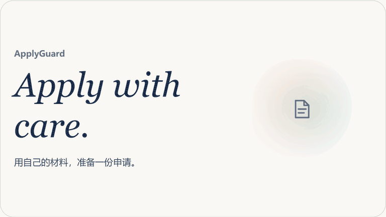

# ApplyGuard · 申请护栏

ApplyGuard 是一个在本机运行的中文求职工作台。给它一份简历、一份岗位说明和手头的项目材料，它会找出相关经历，帮你改写申请稿，并把需要核对的事实标回正文。最后由你决定采用哪句话、补哪份材料，以及导出哪一版。

## Windows 桌面版

从 [Windows 桌面版发行页](https://github.com/yinzzzzz007-code/applyguard/releases/tag/v2026.11.26-desktop-fixes)下载 `ApplyGuard.exe` 并双击启动。程序内含本地后端和 OCR；用户数据保存在程序旁的 `ApplyGuard-data` 文件夹。运行缓存自动选择可写的本机 NTFS，优先使用非系统盘，支持 EXE 放在 exFAT 移动盘。云端模型需在“模型设置”中自行填写服务地址和密钥；DeepSeek Harness 属于独立应用，使用它查找材料前需按页面引导安装并授权。[真实 EXE 验收与已知等待时间](docs/testing-report-2026-11-26-desktop.md)。

现场演示可以从首页“载入完整示例”，然后在“简历审查”或“陈述核验”展开“历史版本”，选择标明“课堂模拟”的记录并点击“回放当时页面”，无需等待云端模型。真实润色和核验也会记录历史。回放后的历史结论仅供参考，修改后仍需重新核验。具体说明见[桌面版使用与验证](桌面版使用与验证.md)。

## 24 秒看懂操作流程

[](docs/media/applyguard-intro.mp4)

上方是从「简历导入」页导出的完整无声预览。带原配乐的视频可以单独下载，适合课堂播放或插入幻灯片。[下载 24 秒 MP4](https://github.com/yinzzzzz007-code/applyguard/raw/refs/heads/main/docs/media/applyguard-intro.mp4)

## 第一次运行

项目使用 Python 后端和 React 前端。以下命令以 Windows PowerShell 为例，项目开发环境使用 Python 3.12 和 Node.js 24。请先确认 `python --version`、`node --version` 和 `npm --version` 都能运行。

```powershell
git clone https://github.com/yinzzzzz007-code/applyguard.git
cd applyguard
.\start-demo.bat
```

脚本会在项目内创建 `.venv`、安装依赖，启动后端和前端，并打开首页。首次安装 OCR 可能需要几分钟。工作台地址是 **`http://127.0.0.1:5173/`**，后端健康检查是 **`http://127.0.0.1:8000/health`**。脚本发现 8000、5173 或 5174 被占用时会停下并提示。结束演示时可以关闭脚本打开的前端和后端窗口。

**想先看界面**，打开首页的「课堂演示」，点击「载入完整示例」即可进入证据匹配。课堂样例和预录的错改、超时演示都可以在没有模型密钥时体验。**想实际调用模型**，先按下文配置自己的服务。

## 用一份公开样例走完全程

仓库提供一套虚构的 **Atlas API Test Toolkit** 求职材料，可以用它体验导入、润色和纠错。请先把这三个文件下载到本机。[示例简历 PDF](eval/public-demo/public-demo-resume.pdf) · [项目证明材料](eval/public-demo/atlas-evidence.md) · [示例岗位说明](eval/public-demo/job-description.txt)

| 进入页面 | 怎么操作 | 完成后能看到什么 |
| --- | --- | --- |
| 1. 简历导入 → 经历库 | 点击「选择简历」，选中样例 PDF。识别完成后点击「导入到经历库」，核对项目名称、职责和日期，点击「保存经历库」。 | 教育和项目成为可编辑的经历卡片。以后准备其他岗位时，可以复用这些经历。 |
| 2. 证明材料 | 导入 `atlas-evidence.md`，打开原文，把它关联到 Atlas 项目。 | 可以回到记录里找到“写了 12 个 Python 单元测试”和“本地原型”两项依据。 |
| 3. 岗位说明 → 证据匹配 | 粘贴样例岗位说明并分析。点开文中着色的职责或要求，查看推荐经历和对应原句。 | 可以看出 Atlas 的 Python API、文档检索和自动化测试分别对应什么要求。 |
| 4. 简历审查 | 检查自动带入的经历，手动补选或移除。配置了模型后，点击「按目标岗位润色简历」，对照原文再采用。 | 每条正文经历都有自己的对照位置。黄色标出文字改动，蓝色提示该建议仍需核查。 |
| 5. 陈述核验 | 点击「启动 AI 原子核验」并确认。想观察数字冲突，可以在样例里把 12 改成 120，保存后再核验。 | 回执给出本次运行编号、耗时和响应模型。展开事实可看材料原句，点正文的着色片段可查看原因。 |
| 6. 导出或准备面试 | 修正数字后可再核验，也可保留自己的表述并导出个人确认稿。要练面试，选择「用当前正文准备面试」。 | 简历预览支持 TXT、可编辑的 LaTeX 和打印为 PDF。面经使用当前选择的经历，支持逐题回答、追问和弱项复练。 |

**这个例子该怎样判断？** 如果岗位需要“自动化测试”，材料中的 12 个单测足以说明这段经历相关。若草稿把数量写成 120，就需要核对同一项目的数字。若只写“优化了测试速度”而材料没有计时记录，用户可以补测速结果、改写这句，或自行确认保留。材料支持的范围和用户最后的选择会分别记录。

## 系统如何选择经历、润色和核验

证据匹配页顶部提供“让 Harness 二次查找并补充经历”。已有有效授权可按当前岗位再次搜索原范围，自动生成可编辑概括；选择“加入本次简历草稿”后直接进入正文，后续可修改或删除。[二次补充与验证说明](docs/testing-report-2026-11-26-harness-secondary.md)。

- **岗位雷达与经历匹配。** 雷达读取部分企业官网公开岗位，结合个人偏好、岗位职责和经历正文排序。点「新增岗位」或「未读提醒」可以逐项打开详情。岗位中的“熟练使用 PyTorch / TensorFlow / JAX 任一框架”按一组选项处理。项目写了训练过程但没写框架时，页面可以给出相关线索，请你确认实际工具。达到 **3.5/10** 的匹配项可自动进入草稿，**6/10** 起优先排列，正文最多 20 条。你可以继续补选、编辑或删除。[岗位来源与刷新说明](docs/official-job-radar.md)
- **针对岗位润色。** 后端把固定版本的 ASu `great-resume` 写作规范、当前正文和可用的同项目材料交给模型。岗位说明决定强调哪些工作，材料用来约束数字、职责与成果。明确冲突的经历优先处理，其他经历可以继续生成建议。教育等个人资料按表单使用。[ASu 版本与第三方说明](THIRD_PARTY_NOTICES.md)
- **逐项事实核验。** SAG 在当前经历已关联的材料中检索片段，原子核验把一句话拆成可独立对照的事实，并检查引文能否定位到原文。每次在陈述核验页确认重新核验，都会发起新的模型请求。缺少关联原件时，模型仍可拆出待核对事实，这些事实保留为待复核。严格导出要求当前正文通过核验；赶时间时可选择个人确认稿，同时保留缺证和冲突记录。[检索与核验设计](docs/sag-grounding.md)
- **面试准备。** ASu `interview` 技能结合岗位和当前正文生成预测题单、自我介绍和参考回答。模拟面试一次提出一个问题，再根据你的回答追问、按预设标准评分，也可以重练薄弱环节。回答作为自述供后续练习使用。[面试技能](third_party/asu-skills/skills/interview/SKILL.md)

## 启用云端 AI

在仓库根目录执行下面的命令，只在首次配置时复制示例。已有 `.env` 可直接编辑。

```powershell
if (-not (Test-Path .env)) { Copy-Item .env.example .env }
notepad .env
```

| 配置项 | 填什么 |
| --- | --- |
| `APPLYGUARD_AI_BASE_URL` | 兼容接口的服务地址，须与自己的密钥对应 |
| `APPLYGUARD_AI_MODEL` | 该账号可调用的常规文本模型名称 |
| `APPLYGUARD_COMPLEX_AI_MODEL` | 用于复杂核验等任务的模型名称 |
| `APPLYGUARD_AI_API_KEY` | 自己的服务密钥，保存在本机 `.env` |
| `APPLYGUARD_GROUNDING_MODE` | 要运行检索和原子核验，使用 `sag_atomic` |

修改后重启后端。使用示例中的 Gemini 网关时，请确认服务支持配置的文本和嵌入模型。DeepSeek 的向量检索路径使用本地 MiniLM；可以用下面的脚本下载模型，再在 `.env` 里设置 `APPLYGUARD_LOCAL_EMBEDDING_DIR=data/local/job-semantic/model` 和 `APPLYGUARD_GROUNDING_STRATEGY=vector`。[完整配置示例](.env.example)

```powershell
.\.venv\Scripts\python.exe scripts/setup_job_semantics.py
```

## 材料与授权

- **本地文件。** 文字 PDF 优先提取文本；扫描简历可用本地 OCR，每次最多 5 页，单个简历文件最大 5 MB。证明材料可导入 Markdown、PDF、Word 和图片。先查看提取的原文，再确认归属。部分草稿保存在浏览器，项目的本地数据、缓存和运行日志存放于 `data/local/`、`output/` 等目录。
- **GitHub 与 DeepSeek Harness。** 可以用用户名、公开邮箱或关键词找公开仓库，查看候选后再读取选定版本的 README。私库读取需要配置 GitHub App，并由用户在 GitHub 授权。Harness 有独立的配对流程，用户选择目录或仓库、确认片段外发规则，再授权检索。手动上传可以独立完成整个流程。[连接与撤销操作](docs/agent-connector.md)
- **模型与投递。** 云端解析、润色、核验和面试功能会向配置的模型服务发送该次任务所需的正文、岗位说明或材料片段，可能产生费用。本地导出完成后，真实招聘网站上的上传和提交由用户操作。

## 遇到问题时

| 现象 | 先看哪里 |
| --- | --- |
| 首页能打开，按钮提示本地服务未连接 | 打开 `http://127.0.0.1:8000/health`，查看是否返回 `status: ok` 和 `service: applyguard-foundation`。若端口被占用，先看启动窗口的提示。 |
| 已经上传证书，陈述仍显示缺少材料 | 在「证明材料」打开证书，核对原文、版本以及关联的具体经历，再回到核验页重新运行。证书可能只支持奖项和排名，项目中的训练细节需要其他原件。 |
| 核验提示超时、限流或未收到回执 | 查看核验按钮下的提示。本地服务健康时，再检查模型名称、密钥权限、余额和服务状态。成功的新运行会显示自己的编号。 |
| 扫描页没有识别出文字 | 检查是否安装 PaddlePaddle 和 PaddleOCR。首次运行可能需要下载模型；超过 OCR 页数限制时可先拆分 PDF。[OCR 依赖](requirements-ocr.txt) |

## 开发与验证

前后端可以分开运行。先在仓库根目录用项目的 Python 环境启动后端，另开一个终端运行前端。

```powershell
.\.venv\Scripts\python.exe -m backend.app
```

```powershell
cd frontend
npm ci
npm run dev -- --host 127.0.0.1 --port 5173
```

下列命令在仓库根目录执行，可检查核验范围、导出边界、前端状态和生产构建。

```powershell
.\.venv\Scripts\python.exe -m unittest tests.test_grounding_scope tests.test_grounding_v2 tests.test_review_export
npm --prefix frontend run smoke
npm --prefix frontend run build
```

后端实现在 `backend/services/`，前端页面在 `frontend/src/pages/`，接口数据约定在 `contracts/`。要追踪某个按钮从页面到后端的完整路径，可查项目地图。真实模型复测、离线回放及预录样例在报告中分别标明。[架构与项目地图](docs/architecture-2026-11-13.md) · [真实复测与复现命令](docs/testing-report-2026-11-24-recording.md) · [岗位匹配评测](docs/testing-report-2026-11-24-job-relevance.md)

此前由姜凌天（Gitvextor）组织的 SAG、原子核验与错改保护实验保留在 `docs/`。ASu、SAG、DocLens、RefChecker 等方法、实现及对应许可详见项目记录。[第三方来源与许可](THIRD_PARTY_NOTICES.md) · [历史贡献与署名](docs/contribution-attribution.md)
