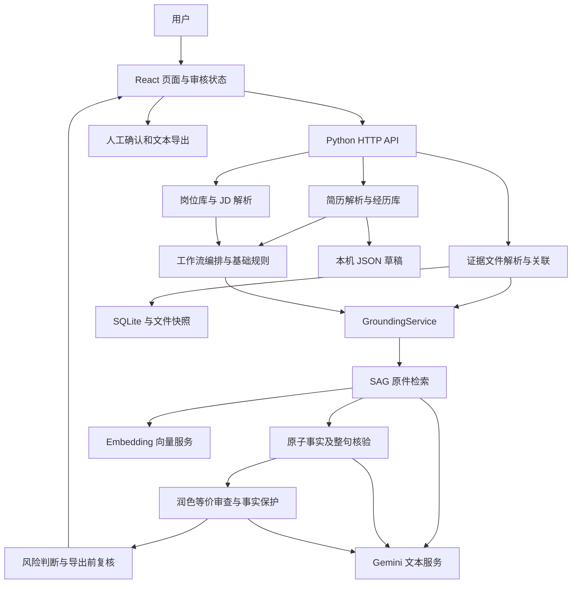

# ApplyGuard 当前实现与代码位置（2026-11-13）

### 陈述核验的操作与故障定位（2026-11-24）

在 `/claims` 点击“编辑陈述”，可在该条直接保存修改或取消。存在多条未保存的编辑时，点“查看原因与补全引导”，云朵先定位距离当前按钮最近的一组保存操作。处理完后移向下一条。补材料和重新核验各自保留发送前确认。

| 页面现象 | 用户操作 | 实现位置 |
| --- | --- | --- |
| 陈述中的短语带蓝框 | 对照下方原子事实、理由及材料原文，选择修改、保留或补材料 | `frontend/src/pages/ClaimVerificationPage.tsx`、`backend/services/structured_verifier.py`。正文摘录须逐字匹配且位置唯一 |
| 页首提示核验中断 | 按具体原因处理后重试。中断的结果不能用于严格导出 | `backend/services/sag_grounding.py`、`backend/services/grounded_workflow.py`、`backend/services/model_client.py` |
| 蓝框围住保存按钮 | 保存或取消框中这条编辑，再继续原操作 | `frontend/src/components/CloudGuide.tsx`、`frontend/src/context/DemoContext.tsx` |

操作回归入口为 `node scripts/claims_guide_browser_smoke.cjs`。启动本机页面后可通过 `APPLYGUARD_TEST_URL` 指定地址，默认 8020；用 Playwright 的 Edge 在隔离窗口验证桌面和窄屏。该用例拦截工作流 API，云端核验另行实测。后端回归入口为 `python -m unittest tests.test_grounding_scope tests.test_grounding_v2`。

11 月 24 日，本机 8020 对当前 3 条简历正文进行了真实 Gemini 复测。最终一轮用时 57 秒，关联到原件的两条共拆出 12 个事实，其中 11 个需要核对，6 个取得正文中的唯一逐字摘录。剩余事实展示核对原因。另一条没有可用原件，严格导出返回 422。浏览器回归另用合成内容验证双编辑、按距离引导、保存/取消、补材料入口和重试。该样本用于验证流程，不能据此估计模型准确率。

2026-11-22 导入修复：简历导入默认优先提取文字；遇到存在页面内容但无法提取文字的 PDF 页时，自动使用本地 OCR 重新识别（最多 5 页），识别结果明确标注 OCR，仍须逐项核对。损坏或其他读取异常不静默降级为成功。运行环境可通过 `APPLYGUARD_OCR_PACKAGES` 和 `PADDLE_PDX_CACHE_HOME` 指定独立的 E 盘软件包与模型目录。启动脚本先加载本地 `.env`，安装缓存和临时目录位于项目 `output`；验证入口：`python -m unittest tests.test_resume_abnormal`，另用真实图片型 PDF 验证 OCR 与字段结果。

本说明按 GitHub 仓库 `yinzzzzz007-code/applyguard` 的 `feature/ui-review-improvements-20261105` 分支核对。代码基线为 `1eab77cbcd86d79a180ce2834ab3a82a777df89f`，提交时间 2026-11-10 11:07 +08:00。它是本机运行的求职材料审核原型，核心是“经历与原件关联 → 岗位匹配 → 简历陈述核验／润色 → 人工确认与导出”。

当前实际运行结构为 React/Vite 前端、Python 标准库 HTTP 服务、JSON/SQLite 本地存储和 SAG 检索引擎。下文包含 11 月 13 日基于上述 GitHub 提交的修复：首页视频、本机 Harness 安装／启动向导及 `/help` 直达。测试结果另见 [本次测试报告](testing-report-2026-11-13-gemini.md)。

2026-11-22 真实文件和岗位刷新验证：见 [本地 OCR 与岗位刷新验证](testing-report-2026-11-22-ocr-job-refresh.md)。教育经历入口还修复了项目符号学校行漏提、院系被拆为独立学校的问题。

2026-11-23 经历库流程更新：`/` 选择 PDF 并识别 → 主按钮“导入到经历库” → `/vault` 未保存卡片 → 编辑／完成编辑 → 统一“保存经历库”。首页没有保存接口调用；新旧内容差异作为卡片建议，默认保留已有内容。`frontend/src/resume/importTransfer.ts` 负责 sessionStorage 交接、草稿合并、原文与建议，沿用原条目编号及材料关联；`ResumeParseResult.source_text` 返回完整识别正文，兼容旧版 preview。操作说明见 [识别结果带入经历库](vault-import-flow.md)。验证入口仍为 `python scripts/verify_vault_flow.py`；本轮仅构建和一次界面跳转检查。

## 1. 整体结构



- 开发时，Vite 默认监听 `127.0.0.1:5173`，把 `/api` 和 `/health` 代理到 `127.0.0.1:8000`。配置见 [vite.config.ts](../frontend/vite.config.ts)。
- 构建后，后端可直接提供 `frontend/dist` 的静态资源及已登记的 SPA 路径。服务入口是 [backend/app.py](../backend/app.py) 的 `create_server()` / `main()`，实现为 `ThreadingHTTPServer`。
- 文本模型与向量服务通过配置的 HTTPS 服务调用。本机保存材料并不意味着模型推理也在本机。
- ATS 是本地模拟表单；当前没有向真实招聘网站自动投递的实现。

## 2. 页面、入口与对应实现

以下前端文件均位于 `frontend/src/`；路由登记在 [App.tsx](../frontend/src/App.tsx)，导航分组在 [navigation.ts](../frontend/src/navigation.ts)。

| 用户看到的入口 | 路径 | 页面文件 | 对应业务与后端 |
| --- | --- | --- | --- |
| 首页／简历导入 | `/` | `pages/ResumeImportPage.tsx` | 首屏呈现 PDF 导入和默认展开的 24 秒操作视频，导入按钮定位 `#resume-import`。PDF 抽取预览调用 `resume_parser.py`，`POST /api/v1/resume/parse` |
| 经历库 | `/vault` | `pages/CareerVaultPage.tsx` | 编辑个人、教育、实习、项目、奖项；`local_store.py` 保存草稿，`resume_draft_vault.py` 转为工作流经历结构 |
| 证明材料 | `/evidence` | `pages/EvidenceWorkspacePage.tsx` | 文件导入、原件预览、字段核对和经历关联；`evidence_workspace.py`、`evidence_parsers.py` |
| 岗位雷达 | `/jobs` | `pages/JobRadarPage.tsx`、`components/OfficialJobRadar.tsx` | 岗位收藏、JD 版本与阶段、官网刷新、匹配和提醒。开发、配置与验证入口见 [官网岗位雷达交接](official-job-radar.md) |
| 岗位说明 | `/jd` | `pages/JdInputPage.tsx` | JD 输入、规则或模型解析，启动工作流；`jd_parser.py`、`skill_router.py` |
| 证据匹配 | `/match` | `pages/EvidenceMatchPage.tsx` | 岗位要求与经历／材料候选、缺口；`evidence_matcher.py`、`ai_evidence_matcher.py` |
| 简历审查 | `/resume` | `pages/ResumeReviewPage.tsx` | 编辑正文、润色预览、等价审核、复核与导出；`grounded_workflow.py`、`wording_review.py`、`review_export.py` |
| 陈述核验 | `/claims` | `pages/ClaimVerificationPage.tsx` | 展示陈述状态、事实拆分、引文和来源；`atomic_verifier.py`、`structured_verifier.py` |
| 网申模拟 | `/ats` | `pages/AtsSimulatorPage.tsx` | 模拟字段映射、复制限制；`reverification.simulator_mapping()`、`risk_engine.py` |
| 最终确认 | `/confirm` | `pages/HumanConfirmationPage.tsx` | 人工确认、复制填写稿、导出前校验、记录模拟结果 |
| 申请记录 | `/history` | `pages/ApplicationHistoryPage.tsx` | 浏览器内模拟申请摘要；`history.ts`，不是招聘平台投递记录 |
| 帮助 | `/help` | `pages/HelpPage.tsx` | 四步操作说明与可选视频；已补齐后端 SPA 路径登记，直接访问和刷新正常 |

前端不是每个页面各自维护一套独立状态：

| 文件／目录 | 职责 |
| --- | --- |
| `context/DemoContext.tsx` | 共享当前 JD、简历表单、工作流、审核决定、导出验证；处理证据变化后的失效 |
| `api/client.ts`、`api/jobs.ts` | HTTP 请求、错误转换、真实／演示场景入口；`api/types.ts` 定义前端数据类型 |
| `resume/review.ts`、`reviewSession.ts` | 审核状态与会话恢复；恢复正文时不继承旧核验授权 |
| `resume/groundingHistory.ts` | 文字版本与回滚；回滚文字不等于恢复证据通过状态 |
| `resume/formModel.ts`、`options.ts` | 表单结构、兼容旧数据和选项 |
| `copyRules.ts` | 控制陈述和字段能否复制，检查最终文字、核验状态与待复核修改 |
| `evidence/materials.ts` | 材料显示状态；解析成功、人工核对、关联经历分别处理 |
| `components/SAGPolishPanel.tsx`、`ReviewDraft.tsx` | 润色、正文编辑和审核操作 |
| `components/AtomicEvidence.tsx`、`EvidenceMatchBoard.tsx` | 原子事实引文及匹配结果展示 |
| `components/GroundedExport.tsx` | 已核验稿／用户确认稿导出入口 |
| `components/AgentConnector.tsx` | 来源授权、每 3 秒自动配对状态、证据候选、导入和撤销 |
| `components/HarnessSetupGuide.tsx`、`agentConnection.ts` | 本机安装检测／步骤、真实路径命令、临时 MCP 配置与连接状态 |
| `components/AppShell.tsx`、`States.tsx`、`i18n.ts` | 页面壳、状态标记、中文文案 |
| `components/ProjectReel.tsx`、`WatercolorReelStage.tsx`、`motion/` | 首页默认展开 24 秒水彩导览，帮助页复用画面、章节、静音播放、进度和减少动态效果 |

## 3. 后端模块具体负责什么

以下服务均在 `backend/services/`。目前是单个 HTTP 服务内的模块分工，没有独立部署的一组微服务。

| 模块 | 输入 → 输出／职责 |
| --- | --- |
| `resume_parser.py`、`resume_sections.py` | PDF → 文字阅读顺序、分节和表单字段；本地规则为基础，可选模型补充，检查模型字段是否来自原文 |
| `local_store.py` | 校验日期、联系方式等并保存 `resume-draft.json`；以保存版本防止覆盖更新 |
| `career_vault.py` | 读取课程演示经历 JSON、基本字段与指标检查 |
| `resume_draft_vault.py` | 用户编辑表单 → 标准 `experience`、`claim`、`evidence_source` 结构 |
| `evidence_parsers.py` | Markdown、PDF、Word、图片 → 原文片段、页码／行号／位置；可选 LibreOffice、PaddleOCR |
| `evidence_workspace.py` | 工作区、文件版本、SHA256、解析片段、材料核对、经历关联、搜索与删除；证据 API 的实际实现 |
| `local_evidence.py` | 把本机有效原件关联附加到经历，供基础工作流读取 |
| `jd_parser.py`、`prompts.py` | JD → 结构化要求及来源片段；模型输出校验、规则回退、提示词版本 |
| `jd_match_scope.py` | 区分个人／教育条件与经历证明，避免把两者的支持状态混在一起 |
| `evidence_matcher.py` | 规则匹配岗位要求与经历，产生相关度、候选与个人条件检查 |
| `ai_evidence_matcher.py` | 可选语义匹配增强；失败可标记为规则回退，不能直接授予事实核验通过 |
| `resume_selector.py` | 从匹配结果挑选简历陈述；适配第三方 bullet selector |
| `claim_validator.py` | 基础确定性检查：陈述归属、证据编号、冲突、指标等；与后续 SAG 模型核验分层 |
| `skill_router.py` | 串联经历库、JD、匹配、选择、核验、字段映射、风险、人工确认、审计；逐模块验证 Schema，失败停止后续步骤 |
| `reverification.py` | 用户编辑后重新构建陈述与映射，避免直接相信客户端传来的已通过状态 |
| `grounded_workflow.py` | 当前核心编排：来源范围、检索、原子核验、润色、等价判断、事实保护、高风险复核、来源失效复查与导出 |
| `sag_grounding.py` | 调用真实 `zleap-sag` 建索引与检索；按候选人／经历限定信源，保存版本缓存，返回可追溯原文 |
| `atomic_verifier.py` | 事实核验与润色接口；真实客户端走结构化核验，另保留模型桩兼容路径 |
| `structured_verifier.py` | 拆分事实、核验原句和每个事实、检查拆分完整性、校验逐字引文、检查数值与单位 |
| `wording_review.py` | OpenAI Agents SDK 驱动的等价判断与最多一次修复；实际文本模型仍为所配置的 Gemini |
| `fact_lock.py` | 事实账本与规则：已核验原文、位置、数字起止、单位、对象和近似限定语等；不保证穷尽所有歧义 |
| `refchecker_review.py` | 可选逐项复核，用 RefChecker 提示词对已有原子事实及引文做额外否决；默认关闭，不能单独赋予核验通过 |
| `edit_guard.py`、`edit_invariants.py` | 改写保真检查、变化审计及局部不变量 |
| `asu_resume.py` | 适配已保留的 ASu 简历写作资源，为润色加入项目约束；上游标签不能替代核验 |
| `risk_engine.py` | 综合陈述、字段及匹配风险，决定阻断／复核和各字段可操作状态 |
| `review_export.py` | 用户确认稿导出：校验最终正文 SHA256、刷新本地规则，明确记录“未经过当前原子核验” |
| `model_client.py` | 共用模型客户端：HTTPS、模型选择、超时、输出限制、结构化输出校验、模型名和用量统计 |
| `schema_validation.py` | 读取 `contracts/` 的 JSON Schema，校验模块输出 |
| `job_radar.py` | 本机岗位 CRUD、版本、阶段、缺口分析、外部 Radar 的只读 API 适配 |
| `agent_bridge.py` | 有期限的来源授权、限定目录／固定 GitHub SHA 搜索、原文证据回传、撤销；授权保存在进程内 |
| `harness_setup.py` | 只读检测本机 Python／MCP／Harness；生成启动器与探针共用的 Gemini 检索 patch，不嵌入密钥 |
| `sag_auxiliary.py` | 另一条可选 SAG 辅助匹配接口，默认关闭；与默认启用的 `sag_atomic` 主核验链不同 |

## 4. 一条简历陈述如何被核验

1. 用户导入简历并核对经历，保存草稿；项目、实习、奖项需要关联材料。姓名、联系方式、教育等走个人资料检查，不算 SAG 证据支持。
2. 证明材料先解析为带位置的原文片段。材料人工核对与关联经历是两次操作。主核验只接纳当前有效、已核对且正确归属的原件。
3. 选择岗位后，JD 解析、匹配与陈述选择建立基础工作流。离线模式会明确跳过模型；模型失败的回退状态不会伪装成模型成功。
4. `GroundingService` 收集来源快照。JD、草稿和模型生成文本不能充当经历原件。
5. SAG 按“支持、反驳、更正”三个方向检索。默认 `full_expand` 使用向量与最多两跳图扩展；生成的事件标签不是证据，最终引用回到原文。
6. `StructuredVerifier` 将每条陈述拆成事实，并同时核对整句。检查引文是否确实存在、是否属于当前候选人与经历；拆分遗漏最多修补一次。
7. 请求润色时，先核验原句，再生成建议、判断等价、必要时最小修复，并重新核验最终文字。事实保护和可选高风险复核都能阻止采用建议。
8. 网络调用结束后再次检查材料版本／关联是否变化。来源被删除、更换或撤销时，使当前结果失效；不能继续沿用旧通过状态。
9. 导出分两条：**已核验稿**要求重新完成核验且全部通过；**用户确认稿**允许保留材料不足／冲突记录，但确认本身不会升级材料支持状态。

| 维度 | 典型值 | 应怎样理解 |
| --- | --- | --- |
| 事实关系 | `SUPPORTED / CONTRADICTED / INSUFFICIENT` | 原文支持、矛盾或不足 |
| 页面核验状态 | `VERIFIED / BLOCKED / NEEDS_REVIEW` | 经历陈述分别映射为通过、阻断、复核；调用失败通常需复核 |
| 表达等价 | equivalent / changed / uncertain | 只说明改写是否保持原义，不说明原句真实 |
| 人工确认 | `user_confirmed` | 用户接受最终文字，不能替代事实核验 |
| 个人资料范围 | `verification_scope=personal` | 可出现内部 VERIFIED 状态，但 `grounded=false`，不能当成经历证据通过 |

## 5. 数据放在哪里

| 数据 | 默认位置 | 生命周期／用途 |
| --- | --- | --- |
| 本机经历表单 | `data/local/resume-draft.json` | 用户保存的草稿；`APPLYGUARD_LOCAL_DIR` 可改目录 |
| 证据索引 | `data/local/evidence/evidence.sqlite3` | `APPLYGUARD_EVIDENCE_DIR` 可改目录；SQLite WAL、外键及锁控制 |
| 原件快照／转换预览 | `data/local/evidence/<workspace_id>/` | 保留文件版本与哈希，定位原件 |
| SAG 索引及缓存 | `data/local/grounding/<candidate-hash>/<snapshot>/<settings-hash>/` | 内含引擎 index、原文、`indexed.json`、`query-cache-v2`；`APPLYGUARD_GROUNDING_DIR` 可覆盖 |
| 岗位库 | `data/local/job-radar.sqlite3` | `opportunities` 和 `opportunity_versions` 两张表 |
| 审核会话／未保存文字 | 浏览器 `sessionStorage` | `applyguard.review-session.v1` 等；恢复时不复用旧批准 |
| 模拟申请历史 | 浏览器 `localStorage` | `applyguard.applicationHistory.v1`；仅模拟摘要，不是服务端投递记录 |
| 外部 Agent 授权 | 后端进程 `GRANTS` 字典 | 默认 30 分钟，到期／撤销失效，服务重启不保留 |
| 工作流审计 | 响应内 `audit_record`、`step_trace` | 当前以响应／内存记录为主，不能视为独立、持久的审计平台 |
| 公开演示样本 | `data/career-vault.seed.json`、`data/evidence-samples/`、`frontend/public/` | 虚构演示素材，与真实用户资料分开 |
| 测试与模型实验 | `output/test-reports/`、`output/`；历史冻结集在 `eval/` | 本次输出被 Git 忽略；历史报告不能当作本次测试结果 |

证据库的关系为：`workspace → source_file → source_span`；`evidence_record` 通过 `evidence_span` 关联片段，`evidence_link` 再把材料关联到经历／奖项，并绑定文件 SHA256。修改同路径文件会形成版本变化，旧关联需复核。

## 6. 主要 API 与契约

统一入口在 `backend/app.py`，主要业务路径如下。各模块的 `handle_*` 函数是完整路由的直接查找入口。

| API | 用途 |
| --- | --- |
| `GET /health` | 后端存活状态 |
| `POST /api/v1/resume/parse` | PDF → 简历表单 |
| `GET / POST /api/v1/resume/draft` | 读取／保存本机草稿 |
| `POST /api/v1/workflow/mock` | 历史命名；当前承载基础工作流并接入 grounding，不代表请求必定为假数据 |
| `POST /api/v1/workflow/reverify` | 编辑后的重新核验 |
| `POST /api/v1/resume/polish` | 润色与后续保护流程 |
| `POST /api/v1/resume/export` | 已核验稿／用户确认稿导出 |
| `/api/v1/evidence/workspaces`、`.../{id}/files` | 建立工作区、列出或导入文件 |
| `/api/v1/evidence/files/{id}`、`.../preview`、`.../reparse` | 文件信息、预览、重新解析；支持删除 |
| `/api/v1/evidence/{id}/review`、`.../links`、`.../links/remove` | 材料核对、建立或撤销经历关联 |
| `/api/v1/evidence/search`、`.../check-claim`、`.../workspaces/{id}/match-resume` | 本地搜索和材料候选检查；不等于完整原子核验 |
| `/api/v1/jobs`、`.../import`、`.../{id}/versions` | 岗位列表、导入、版本；另有 edit、stage、analyze |
| `/api/v1/jobs/radar`、`.../radar/import` | 读取并导入外部本机 Radar 岗位 |
| `POST /api/v1/agent/ui`、`.../agent/call` | 同源界面环境检测、授权、状态、撤销；Agent 令牌预检／任务／搜索／回传；预检不标记配对 |

`contracts/` 的九份 JSON Schema 分别是：`experience`（经历）、`parsed-jd`（岗位要求）、`evidence-match`（匹配）、`resume-claim`（陈述）、`claim-verification`（核验）、`form-mapping`（表单映射）、`risk-result`（风险）、`audit-record`（审计）、`error`（错误）。前端对应类型见 `frontend/src/api/types.ts`。

## 7. 模型、外部集成与配置

本次已在独立检出目录的 `.env` 中统一普通、复杂、高风险复核文本模型；该文件不含密钥且被 Git 忽略。密钥只通过隐藏输入进入测试进程。

| 配置项 | 本次值 | 使用位置 |
| --- | --- | --- |
| `APPLYGUARD_AI_BASE_URL` | `https://api.chatanywhere.tech/v1` | `HttpModelClient`、SAG、wording SDK |
| `APPLYGUARD_AI_MODEL` | `gemini-3.1-flash-lite-preview` | 简历／JD 解析、语义匹配、SAG 文本处理 |
| `APPLYGUARD_COMPLEX_AI_MODEL` | 同上 | 原子事实核验、润色与保真判断 |
| `APPLYGUARD_STRONG_AI_MODEL` | 同上 | 可选高风险二次判断；本次启用且不切换其他文本模型 |
| `APPLYGUARD_EMBEDDING_MODEL` | `text-embedding-3-small` | SAG 向量化，1536 维；文本生成模型不能直接替代 embedding |
| `APPLYGUARD_GROUNDING_MODE` | `sag_atomic` | 默认要求原子核验，客户端不能主动降级 |
| `APPLYGUARD_GROUNDING_STRATEGY` | `full_expand` | SAG 向量与图扩展检索 |

OpenAI Agents SDK 在这里是兼容 API 的调用框架，不代表系统使用了 GPT 模型。`wording_review.py` 显式传入 Gemini 模型、ChatAnywhere 地址，关闭 SDK tracing 和隐式重试。

其他集成：`scripts/agent_mcp.py` 以 MCP stdio 提供 `get_task`、`search_materials`、`submit_evidence`；外部 Radar 默认在 `127.0.0.1:8787`，仅导入岗位；LibreOffice 支持旧 Word 转换，PaddleOCR 支持扫描件／图片识别，均为可选本机依赖。

第三方代码与资源见 `THIRD_PARTY_NOTICES.md`、`backend/services/third_party/`、`third_party/asu-skills/`、`vendor/kinetic-reel/` 和 `third_party_licenses/`。它们分别服务于陈述筛选、指标算术、输入清洗、写作参考及动效，不应混作同一“核验模型”。

## 8. 如何运行、验证和修改

本次独立检出目录为 `applyguard-gemini-20261113`，使用外层工作区现有 `.venv`，依赖按本提交的 `requirements-sag.txt` 补齐。以下命令在此检出目录运行；普通新克隆可先创建自己的 `.venv` 并调整 Python 路径。

```powershell
# 输入密钥时隐藏，不写入文件
..\.venv\Scripts\python.exe scripts/run_grounded.py

# 另一个终端启动前端
cd frontend
npm run dev -- --host 127.0.0.1
```

| 想验证／修改什么 | 首先找哪里 | 现有验证入口 |
| --- | --- | --- |
| 全量后端行为 | `backend/`、`tests/` | `python scripts/run_test_report.py --label <label> --all` |
| 前端构建与审核状态 | `frontend/src/` | `npm run build`、`npm run lint`、`npm run smoke` |
| 简历读取异常／分节 | `resume_parser.py` | `test_resume_abnormal.py`、`test_resume_sections.py` |
| 文件导入、版本、关联与本地 OCR | `evidence_workspace.py`、`evidence_parsers.py`；可用 `APPLYGUARD_OCR_PACKAGES` 指定库目录、`PADDLE_PDX_CACHE_HOME` 指定模型目录 | `test_evidence_workspace.py`、`test_docx_extract.py`；真实 OCR 应检查结果为通过而非跳过 |
| JD 与经历匹配 | `jd_parser.py`、`evidence_matcher.py` | `test_jd_chinese_offline.py`、`test_jd_match_scope.py`、`test_ai_evidence_matcher.py` |
| SAG 与事实核验 | `grounded_workflow.py`、`sag_grounding.py` | `test_grounding*.py`、`test_quote_alignment.py`；真实模型需额外执行 live 测试 |
| 改写不能改事实 | `wording_review.py`、`fact_lock.py` | `test_wording_review.py`、`test_numeric_wording_regression.py`、`test_edit_preservation_v2.py` |
| 扩展歧义压力测试 | `scripts/evaluate_ambiguity_expansion.py`、`fact_lock.py` | 用 `--output <新目录>` 运行 280 条离线合成组合，退出码 1 表示有发现；真实模型抽样使用 `scripts/evaluate_ambiguity_live.py --cases <cases.json> --output <新目录>`，修复结果需复核；[本轮结果和边界](testing-report-2026-11-13-ambiguity.md) |
| 更多职责、范围与状态歧义 | `scripts/evaluate_ambiguity_broad.py`、`fact_lock.py`、`edit_invariants.py` | `python scripts/evaluate_ambiguity_broad.py --output <新目录>`；2,800 条模板案例不是独立模型准确率；[修复与实测](testing-report-2026-11-13-ambiguity-repair.md) |
| 图片简历本地 OCR | 首页简历识别方式选择本地 OCR → `resume_parser._pdf_local_ocr` → `evidence_parsers._run_local_ocr` → `resume_sections.py` | `python scripts/evaluate_resume_ocr.py --output <新文件> <pdf...>`；`--replay-ocr` 回放已保存正文，`--expected-education` 等可检查手工计数；统计条数不等于准确率 |
| 事实与引用人工标注汇总 | `scripts/evaluate_doclens_audit.py` → `third_party/doclens/aggregate_scores.py` | `python scripts/evaluate_doclens_audit.py --input eval/doclens-example.json --output <新文件>`；需可选 `requirements-audit.txt`；只汇总标签，不自动验真 |
| RefChecker 提示词复核 | `refchecker_review.py`、`third_party/refchecker/`、`scripts/evaluate_refchecker_pilot.py` | `--input eval/refchecker-pilot.json --output <新文件> --live` 只发送给定案例；设置 `APPLYGUARD_REFCHECKER_AUDIT=1` 可启用改写额外否决，额外调用模型，详情见[研究记录](research-2026-11-13-factuality-ocr.md) |
| JPEG 转图片型 PDF | `scripts/images_to_resume_pdfs.py` | `tests/test_images_to_resume_pdfs.py`；逐页校验原图字节，`--merge` 可另建多页版本。该格式无文字层，默认本地模式会自动转到 OCR |
| 图片简历 OCR 及字段抽取 | `evidence_parsers.py` 的 OCR 引擎、`resume_parser.py`、`resume_sections.py` | 默认本地模式或显式本地 OCR 可读取图片 PDF；教育字段仍可能漏提，历史截图结果见[本轮报告](testing-report-2026-11-13-ambiguity.md) |
| 人工确认与导出分离 | `review_export.py`、`copyRules.ts` | `test_review_export.py`、前端 review／copy-rules／review-session 测试 |
| 岗位与外部 Agent | `job_radar.py`、`agent_bridge.py` | `test_job_radar.py`、`test_agent_bridge.py`、`test_agent_mcp.py` |
| 本机 Harness 接入与迁移 | `harness_setup.py`、`scripts/connect_harness.py`、`HarnessSetupGuide.tsx`。检测项目根目录并生成可复制安装命令 | `test_harness_setup.py`、`agent-connection.test.mjs`、`scripts/agent_browser_smoke.cjs`、`scripts/harness_agent_probe.py` |
| 水彩配色、首页导览与导入入口 | `frontend/index.html`、`palette.css`、`ResumeImportPage.tsx`、`ProjectReel.tsx`、`WatercolorReelStage.tsx`、`workspace-polish.css`、`components/ui/` | `scripts/home_browser_smoke.cjs`（验证样式、按钮、键盘、章节、移动布局和浏览器强制深色下的历史页纸色，输出截图） |
| 工作台视觉规范 | `DESIGN.md`、`frontend/src/palette.css`、`frontend/src/workspace.css`、`frontend/src/workspace-polish.css`、`frontend/src/components/ui/` | `npm run build`、`npm run smoke`。首页浏览器回归检查配色、字号层级、键盘焦点和减少动态效果 |
| `/help` 后端直达／刷新 | `backend/app.py` SPA 路径表 | `tests/test_api.py` 的 `test_help_deep_link_serves_spa` |

`scripts/live_grounding_pilot.py` 使用五组虚构材料，包含支持句、错误句及仅检索润色预览。它的退出码不能代替效果检查，必须读 `grounding.error` 与各条核验状态；本次另记录默认原子模式的完整 HTTP 复测。详细结果和限制见本次测试报告。

当前范围仍是本机原型：真实中文 OCR 已通过一项合成图片用例，不能代表多种扫描质量下的准确率；真实招聘投递、外部 Radar 的在线运行、独立真人标注的模型准确率以及生产级多用户隔离，尚未由本次自动化测试验证。

2026-11-23 文件夹入口：`AgentConnector` 通过现有本机同源 `/api/v1/agent/ui` 的 `pick_folder` 动作调用系统选择窗口；前端连续追加、去重、移除，最多五个目录。选择不创建授权，最终仍由 `create` 校验并授权。实现与验证入口见 [连接文档](agent-connector.md)。

## 11. 本机 Harness 一次检索的路径

`/evidence` → `AgentConnector` → 同源 `/agent/ui setup` → 检测并显示安装步骤 → 用户选择材料与外发规则 → `/agent/ui create` 返回 30 分钟能力凭据 → 复制生成的 PowerShell 命令 → `scripts/connect_harness.py`。

启动器先调用 `/agent/call prepare` 校验有效性和云端授权，再创建独立临时 profile，启动已安装的 `dsh`。Harness 的 MCP stdio 插件运行同一 Python 下的 `scripts/agent_mcp.py`，经本机 HTTP 使用三个工具：`get_task`、`search_materials`、`submit_evidence`。模型和 API 地址取当前配置，Key 隐藏输入，仅传运行进程。

只有实际 `get_task` 后后端才标记配对。前端轮询拿到候选原文；用户核对归属、数字后导入原工作区，随后仍经过材料关联与原子核验。Harness 不能直接批准陈述。离页／撤销／超时使凭据失效，独立检索进程退出后清理临时 profile。完整操作见 [连接文档](agent-connector.md)。


2026-11-23 早期 Harness 复测：当时只完成配对，检索回传失败；后续恢复及新 Key 完成记录见文末最终报告。早期证据与 CLI 见 [文件夹选择与 Harness 报告](testing-report-2026-11-23-folders-harness.md)。

## 2026-11-23 目录弹窗与按钮审查

目录选择采用 `pick_folder → folder_status / cancel_folder` 异步任务：`backend/services/folder_picker.py` 管理唯一窗口、可见启动、超时与取消；`AgentConnector.tsx` 轮询并提供“取消选择”。选择目录不会授权或扫描；成功后连续追加，最多五个，去重和移除仍由 `agentConnection.ts` 与界面处理。同源访问校验继续由 `backend/app.py` 负责。

导入交接会移除未填写的历史 `edu_1` 占位行，保留手工填写及稳定经历 ID；重复导入保留已有描述，差异进入卡片建议。帮助页与首页短片共用的 `motion/onboarding.ts` 已同步“选择 → 导入到经历库 → 编辑 → 保存”的说明。

验证入口：`python scripts/verify_ui_actions.py --build`。默认运行目录窗口、连接器、MCP 与前端动作状态检查，保存日志及 JSON 到 `output/test-reports/*_ui-actions/`。它不会代替实际弹窗、官网网络或模型的端到端证据。逐页实际点击记录见 [按钮与流程审查](testing-report-2026-11-23-ui-actions.md)。真实 Harness 连接的阶段与失败边界见 [连接测试](testing-report-2026-11-23-folders-harness.md)。

## 2026-11-23 分层诊断与恢复

真实 Harness 已再次跑通 get_task → search_materials → submit_evidence：探针 32.876 秒，正式启动器 61.503 秒，页面完成原文确认导入。已给正式启动器增加默认 240 秒会话时限，单次模型尝试／流式空闲 90 秒、最多重试一次，并显示领取、搜索、回传、异常结束和超时阶段。运行目录在项目 `output/harness-runtime`。本轮成功和原有失败分别保留，完整证据见 [诊断与恢复报告](testing-report-2026-11-23-harness-recovery.md)。

GitHub 可选入口新增点按引导：`AgentConnector.tsx`、`GithubGuideTip.tsx`、`githubGuide.ts` 与 `github-guide.css` 负责五步定位、红点、校验与跳过。后端仅检测是否存在凭据；私有仓库缺凭据时，在创建授权前失败。`scripts/diagnose_harness_model.py` 是独立模型／工具协议诊断入口；`scripts/verify_ui_actions.py --build` 已纳入共享会话截止与引导状态检查。GitHub 真实授权／私有仓库读取尚未进行，需要明确的仓库范围授权。

## 2026-11-23 按钮补全引导、公开发现与语义推荐

| 用户入口与触发 | 实现与预期证据 | 验证入口 |
| --- | --- | --- |
| 首次使用，或页头“云朵引导” | `components/CloudGuide.tsx`、`guide.ts`、`cloud-guide.css`；自绘 #87CEEB 云朵，在导入、保存、关联、岗位分析等真实完成回调后提示下一步；可关闭、重开、减少动态效果 | `frontend/scripts/cloud-guide.test.mjs`；实际首次／补全点击截图见本轮报告 |
| 禁用按钮旁“查看原因与补全引导” | `components/ui/action-button.tsx` 保留原生 disabled，明确显示原因；有准确目标的缺项按距按钮的文档坐标距离排序，补齐后才移动一次；等待／已保存等只解释状态 | `frontend/scripts/button-inventory.mjs`，禁止新增无原因的条件按钮；`scripts/verify_ui_actions.py --build` |
| 证明材料 → Agent → GitHub | `GithubSources.tsx`、`github_discovery.py`；用户名、公开邮箱候选、关键词查询公开元数据 → 选择仓库 → 固定 SHA → 单独授权读取；私有权限不随查询扩大 | `tests/test_github_discovery.py`；本轮实际返回公开仓库列表 |
| 岗位雷达统计卡片 | `RadarDialog.tsx`、`OfficialJobRadar.tsx`；提醒列表 → 单条详情 → 岗位；原列表保留，翻页不静默截掉 200 条以后提醒 | `tests/test_job_recommendation.py` 的提醒分页；实际弹窗截图 |
| 岗位雷达默认推荐 | `job_recommendation.py` 本地 MiniLM 语义向量 + 偏好与可撤销兴趣反馈 + 公司／重复项打散；`job_radar.py` 提供 feedback API；向量不发云端 | `scripts/setup_job_semantics.py`；`tests/test_job_recommendation.py`；个人实测排序报告 |
| 简历审查 → AI 简历润色 | `SAGPolishPanel.tsx` 提升到正文上方；ASu great-resume 只规范建议，原子核验与错改保护仍独立；先预览再采用 | `scripts/evaluate_personal_resume_flow.py --all-claims --live --interview`，失败后可用 `scripts/retry_resume_polish.py` 复用同一批源版本 |
| 索引存储异常／长简历模型等待 | `sag_storage.py` 在模型前检查硬链接；exFAT 给出 NTFS 提示；`scripts/check_sag_storage.py` 可单独检查。共享 fetch／面经上限 600 秒，Vite 代理 630 秒，避免后端 185 秒完成但页面 180 秒中止 | 本轮真实 14 条简历润色 185.45 秒；预算源码检查和实际结果分别记录 |

默认 OCR 批量复查：`python scripts/evaluate_resume_ocr.py <PDF路径…> --parse-mode offline --output output/<新文件>.json`。默认 offline 与首页一致，会对图片页自动尝试本地 OCR。计数不代表逐字准确。

完整证据、限制与后续需本人确认事项见 [最终复查记录](testing-report-2026-11-23-final-personal-flow.md)。个人 CV、材料正文、模型结果位于 gitignored output，不进入公开报告。


## 本轮真实云功能复查入口

| 用户动作 | 当前共享边界 | 必要证据与 CLI |
| --- | --- | --- |
| 简历识别选择 AI | `resume_parser.py` 按字段核对来源，舍弃无原文依据字段；`resume_sections.py` 保留规则字段，没有实习上下文时不凭项目标题重复建立实习 | `tests.test_resume_abnormal`、`tests.test_resume_sections`；真实 counts 为教育 1、项目 10、实习 0、奖项 3 |
| 离线解析岗位后主动点 AI 润色／核验 | `resume/modelReview.ts` 按当前操作选择 transport；`SAGPolishPanel.tsx` 页面内确认，取消不调用模型 | `cloud-guide.test.mjs`；真实模型模式不能被历史 `local_only` 静默改成离线 |
| 用户改数字 → 保存 → 重核验 | `reviewSession.ts` 使旧核验失效；`structured_verifier.py`、`fact_lock.py` 识别合法千位分组，仍阻止错数字／单位 | `tests.test_grounding_v2`；手动按证书校正名次和分母后重新核验 |
| 长原件的原子核验与润色 | `sag_grounding.model_sources` 保留完整正文、来源 ID、候选人和经历范围，省去模型不需要的索引元数据；服务器仍按完整原件校验引用位置、哈希与版本。原子核验每请求一条陈述 | `tests.test_grounding_v2` 的真实来源位置保留检查；不截断证据、不放宽事实门禁 |
| 云调用等待／岗位解释 | `model_client.py` 复杂调用默认 90 秒、普通 60 秒；岗位 AI 解释 30 秒；前端岗位操作 60 秒，简历模型操作 600 秒 | 外部 503／超时仍可能发生。`HTTP 200 + grounding.error` 必须记录为未完成 |
| 受限真实测试与账单 | `scripts/evaluate_cloud_features.py` 隐藏输入 Key、固定 Gemini、调用前预留预算、阶段后查账单，`--only` 可重试单项；`scripts/summarize_cloud_features.py` 汇总真实状态 | `python scripts/evaluate_cloud_features.py --help`；`python scripts/summarize_cloud_features.py <report.json…> --output output/<summary>.json --balance-check`；未通过返回非零 |

默认链路覆盖简历 AI 抽取、JD 解析、语义匹配、SAG 原子核验、ASu 润色及改写核对、严格导出复核、面经、可选岗位 AI 解释、Harness 工具回传。可选 RefChecker 额外审计另外做单句组件探针，结果与个人简历前置核验分开；所有检索策略的消融不在本轮功能测试范围。

中文录屏步骤与逐句英文说明见 [演示指南](demo-recording-guide-2026-11-23.md)。`eval/public-demo` 为虚构公开素材；个人 CV 和私人原文不作为公开测试集发布。

## 云朵引导按页面定位（2026-11-23）

`frontend/src/guide.ts` 的 `GUIDE_PAGES`／`guideForPage` 定义全部 13 条业务与帮助路由的独立提示；当前页真实完成后才提示下一步，不能用全站第一个未完成步骤代替当前页。`reopenGuide` 只解除隐藏，保留完成记录。`CloudGuide.tsx` 将按钮缺项绑定路由并在切页清除；异步内容出现后重定位，保留距离排序和减少动画设置。

验证入口仍为 `scripts/verify_ui_actions.py --build`，其前端 smoke 纳入 `frontend/scripts/cloud-guide.test.mjs`。本轮 69 项前端检查及构建通过；13 页实际切换、刷新和重开记录见 [修复报告](testing-report-2026-11-23-cloud-guide-pages.md)。


## 简历正文自动选入与补选（2026-11-23 历史版本，当前行为见文末）

`frontend/src/resume/draftSelection.ts` 从经历库当前快照和已分析岗位的匹配结果挑选最多 3 条相关经历，作为 `DRAFT`／`NEEDS_REVIEW`，与证据支持分开；语义分或关键词覆盖用于排序，不按证据强弱冒充相关性。已有正文、已编辑内容、跨候选人或预录样例不覆盖。无匹配时说明并允许手选；只对空草稿初始化一次，持久保存 `draft_initialized`，删除后刷新不会重新填入。已打开的既有草稿会保留。

`ResumeReviewPage.tsx` 提供经历名／内容搜索、类型筛选和下拉选择，正文已存在的经历按 ID 和内容过滤；`ReviewDraft.tsx` 每条有“从正文移除”和撤销。补选／移除后保留当前文字、使旧核验失效。云朵默认折叠；显式点击时根据当前草稿状态提示，缺项引导仍按距离排序，鼠标经过禁用按钮不会自动打断。

验证：`npm --prefix frontend run smoke`（包含 `draft-selection.test.mjs` 和 `cloud-guide.test.mjs`），`npm --prefix frontend run build`。独立 8017 测试副本中实际观察自动选入 3 条、移除后刷新仍为 2 条、下拉补回后候选消失；没有发送模型请求。有关界面和细节见 `docs/testing-report-2026-11-23-draft-selection.md`。


## 润色对照与教育信息（2026-11-23）

`ReviewDraft.tsx` 在每条经历中直接展示原文、润色建议和针对建议本身的核查状态，`change_audit` 仅是字符差异，不自动声称修改意图；大幅改写以完整段落对照为主。建议需要用户主动采用，过期草稿需重新生成，采用后仍重新核验。`atomic_verifier.POLISH_PROMPT` 要求突出真实贡献、技术和岗位相关性，避免无意义换词；实际生成效果仍需真人检查。

`resume/review.ts:isEducationProfile` 仅在陈述 ID 与当前教育表单内容严格匹配时标记为基础资料；`ClaimVerificationPage` 将其从经历的待复核统计中区分，修改学历到经历库进行。后端仍以自身表单和文本比对判断，不因客户端显示跳过核查。

验证入口：`npm --prefix frontend run smoke`、`npm --prefix frontend run build`、`python -m unittest tests.test_grounding_v2 tests.test_edit_preservation_v2 tests.test_resume_draft_vault`。隔离页面回放先前真实 Gemini 结果检查展示，不作为修改后模型质量实测；用户测试后应重启后端以加载新的润色指令。

本轮已重启 8015 隔离测试后端以加载新润色指令，用户草稿沿用原目录。页面对照使用先前真实 Gemini 的隔离回放结果确认，未以旧输出证明新指令的润色质量；后续实际生成仍需观察。

## 当前正文逐条润色（2026-11-23）

`grounded_workflow.py` 将用户当前正文中全部非个人资料陈述送入 ASu great-resume 润色，包含手动添加的经历；不扩展至未选入正文的经历库条目。`atomic_verifier.py` 要求逐条返回建议，候选人专属材料可用时对改写进行事实核查；缺少材料的内容显示未核验，不能视为已通过。教育资料按现有资料规则处理。模型遗漏条目时界面会提示，不将未返回视为成功。

`ReviewDraft.tsx` 展示每条完整原文、建议、差异及建议核查状态，正文编辑框随内容展开；建议须用户决定是否采用。验证入口：`python -m unittest tests.test_grounding_v2 tests.test_edit_preservation_v2 tests.test_wording_review`，`npm --prefix frontend run smoke` 和 `npm --prefix frontend run build`。隔离页面用先前模型结果检查长文本显示；这不代表新指令已经完成真实云模型复测。

## 润色与正式核验分开（2026-11-23）

`SAGPolishPanel.tsx` 在缺少原件时仍按正文生成建议并说明尚未核验；有来源时沿用 SAG 检索、ASu great-resume 和参考 ALCE/FActScore 的原子事实检查与改写保护。`ClaimVerificationPage.tsx` 的“启动 AI 原子核验”经用户同意后，`DemoContext.reverifyClaims(true)` 明确请求 `sag_atomic` 和模型模式；展示原子事实、引用，交用户编辑、保留或排除。结果中的模型错误不再被静默当作成功。关联岗位不存在时 `job_radar.validate_target` 返回明确的中文处理提示。

验证：相关 43 个后端测试、32 个岗位测试和前端构建通过。隔离浏览器实际点击验证了模型发送确认和岗位缺失提示。真实 Gemini 在两条无有效关联原件的正文上返回两条 ASu 润色建议，正式核验均维持 BLOCKED，见 `output/cloud-polish-formal-20261123/report.json`。补齐证据的另一次测试在 SAG 建索引阶段耗时过长而主动停止，不能宣称新版有材料云端核验通过。测试后 API 累计用量为 0.85851546 CA；不是本次单次费用。CLI 可用 `--claim-id` 限制参与测试的正文，完整参数见 `python scripts/evaluate_cloud_features.py --help`。

## ASu 完整简历指导、润色对照与补证重核验（2026-11-23）

比对 ASu 上游 main `5d6592acadcd77385a884c1de042986486cfe2bc` 与项目锁定版本：忽略换行后，`great-resume/SKILL.md`、两份参考资料、证据账本模板、验证器和 MIT 许可证内容一致。`asu_resume.proposal_policy` 每次提供完整简历技能及两份参考，业务分析内容仅在相关时使用；范围仍限于用户当前正文的改写，不执行投递、发信或其他技能。SAG 与原子检查先读取可用材料，改写后重新核查；没有有效原件的内容可忠于原文润色，但不授予已核验状态。

`ReviewDraft.tsx` 显示真实的原文／建议差异：蓝色标出改写，橙色表示整条建议需复核，不声称精确定位风险；删除内容在原文上标注。无结果时可在当前面板直接打开润色确认，已采用、原文不变和个人教育资料分别说明。`ClaimVerificationPage.tsx` 展示需复核原因与原子事实，并提供编辑、知情保留、补充材料。经明确同意后，`supplementRecheck.ts` 将申请、候选人、目标经历及有效期绑定；仅用户确认关联对应材料后自动返回并启动重核验，不自动修改正文。缺少经历库对应条目的手写内容需先加入经历库。未核验的知情保留不会成为已核验，可导出用户确认稿。

验证入口：`python -m unittest tests.test_asu_resume tests.test_grounding_v2 tests.test_edit_preservation_v2`（43 项）、`node --experimental-strip-types --test frontend/scripts/review.test.mjs`（10 项）和 `npm --prefix frontend run build`。隔离页面使用虚构材料实际测试了生成按钮、差异高亮、材料选择和关联后的自动返回；副本缺少关联岗位，重核验显示岗位缺失，因此没有证明云模型端到端成功。有关已授权个人材料的真实新版本云测试也未在本轮重跑；上次有证据的 SAG 建索引耗时过长已中止。

## Gemini 连通性与润色入口互锁（2026-11-23）

简历审查的主按钮和快捷入口共用后台润色任务。确认后，`POST /api/v1/resume/polish/start` 交给本机后端执行；返回页面通过 `POST /api/v1/resume/polish/status` 读取进度和已有建议。页面可以切换、刷新或关闭。后台服务需保持运行。重复提交进行中的相同申请只启动一次。旧的同步 `/api/v1/resume/polish` 接口继续供评测 CLI 使用。

任务索引在本机工作区的 `local/polish-jobs/`，正文、岗位和候选人参与匹配，结果引用 `local/verification-runs/` 原始记录。取回结果前会核对材料快照，未保存的编辑优先。浏览器展示原文与建议，用户可逐条决定是否采用。回归入口为 `python -m unittest tests.test_polish_navigation`。

简历审查页读取 `/health` 的 `cloud_model_configured`。缺密钥时，主润色按钮、快捷入口和模型核验显示配置原因。本地检查仍可用。配置就绪后，点击润色并确认才发送岗位、经历及材料。配置标记只检测密钥是否存在，账户额度和上游响应在调用时单独检查。

在仓库根目录启动 8032 同一份演示草稿：`python scripts/start_recording_workspace.py --port 8032 --workspace output/relevance-preview --cache output/relevance-preview/cache --cloud`。云端启动优先使用当前进程的 `APPLYGUARD_AI_API_KEY`，也可在隐藏提示中输入演示密钥。启动器先读取累计账单，运行中沿用 15 元预算保护。省略 `--cloud` 会进入离线模式。可用 `python -m unittest tests.test_api.ApiTests.test_health` 检查两种配置的响应。

`ReviewDraft.tsx` 将下方按钮标注为快捷入口，主按钮和快捷按钮通过 `resume/operationLock.ts` 在本页会话共享锁；等待确认及请求进行中两者禁用，鼠标悬停和按钮下方说明它们功能相同并需等待。取消、成功和失败时释放；请求进行中切页再返回仍读取共享锁。`ActionButton` 为禁用容器添加原因提示。

`scripts/probe_gemini.py --output <report.json> [--structured]` 在隐藏输入密钥并检查累计账单后，最多发两次不含个人资料的短请求。2026-11-23 普通文本和 JSON Schema 各一请求均 HTTP 200（分别 1.71 秒、3.25 秒），累计用量从 1.11941878 至 1.11952078 CA；该探针不证明含真实材料的完整润色和核验持续可用。历史 503 只说明服务当时不可用，无法据此区分网关与上游。

验证：`node --experimental-strip-types --test frontend/scripts/review.test.mjs`、`npm --prefix frontend run build`；隔离页面实际检查两个入口在确认、请求期间禁用，以及取消或接口错误后恢复。切页状态由共享锁及订阅单元检查，未用较长的真实云调用验证。

## 503 时真实建议与历史状态（2026-11-23）

用户实际遇到的响应在 `grounding.error_code=MODEL_SERVICE_UNAVAILABLE` 且建议数为 0 时，旧前端仍写入“建议已生成”的历史标题。`SAGPolishPanel.tsx` 现在根据实际建议数量和核验错误生成记录；`GroundingHistory.tsx` 对旧记录中已有空建议列表的错误标题作显示纠正，不删除用户历史。

`grounded_workflow.py` 按材料检索、原文原子核验、润色生成、改写核验记录失败阶段。检索或原文核验失败时尝试一次 ASu 忠实改写：仍使用已检索到的候选原文，但所有建议标为未核验，仅供人工选择；如果建议已生成而后续检查失败则保留预览。事实状态不会升级，正文不自动覆盖，严格核验稿仍由服务端拦截。模型继续不可用时明确告知没有生成建议。`edit_invariants.py` 对“检查是否”升级成“验证了”增加风险提示；该规则不代表识别所有语义变化。

真实隔离复测：用户当前 3 条正文及原关联材料，目标岗位绑定，`evaluate_cloud_features.py --only ai_resume_polish --bind-target`；48.64 秒返回 3 条建议，其中 2 条检索到材料、1 条没有有效材料；原文原子核验遇到 503，3 条均未核验，不构成完整成功。成本 0.058091 CA，累计 1.18139278 CA。新增本地检查对这批真实输出重新分析，前两条出现“检查是否”变为“验证了”的风险提示；UI 隔离回放用真实输出加重新计算的风险提示，见 `output/polish-503-personal-report-20261123`。源正文的竞赛名次和分母仍与同项证书不一致；本次未自动纠正。

验证：`python -m unittest tests.test_asu_resume tests.test_grounding_v2 tests.test_edit_preservation_v2` 47 项，`node --experimental-strip-types --test frontend/scripts/review.test.mjs` 12 项，`npm --prefix frontend run build` 均通过；CLI 增加 `--bind-target` 和润色阶段 `passed`，不把有核验错误的 HTTP 200 当完整通过。尚未用本版跑出有材料且原文、改写原子核验全部成功的真实云结果。


## 2026-11-24 演示前复查

全量后端和 UI 构建、OCR 边界、隔离岗位刷新、真实 Harness、用户确认稿导出及个人云功能的范围和结果见 [演示前复查](testing-report-2026-11-24-demo.md)。当前云端原子核验及严格导出遇到模型超时或 503，不能标记为通过。

验证入口：项目 Python 下 `python scripts/run_test_report.py --label <名称> --all`、`python scripts/verify_ui_actions.py --build`、`python scripts/check_running_resume.py --port <端口> --cv <PDF>`；云调用使用 `scripts/evaluate_cloud_features.py`，缺少或失败阶段现在返回非零，汇总用 `scripts/summarize_cloud_features.py`。`tests.test_cloud_reporting` 覆盖规则回退不冒充模型成功。`start-demo.bat` 检查 SAG 并在端口冲突时停止启动，不终止其他后端。

## 2026-11-24 润色和核查分流

简历审查页的 `SAGPolishPanel` 调用 `resume/polish`。后端由 `sag_grounding.py` 检索、`structured_verifier.py` 区分支持、反证与缺证，`asu_resume.py` 加载 ASu 原文，`atomic_verifier.py` 只暂停有反证的经历并改写其余经历，`grounded_workflow.py` 复核建议及严格导出。页面 `ReviewDraft.tsx` 直接展示冲突引文、黄色改动和蓝色核查提示；`resume/review.ts` 决定优先查看哪条。实际结果、503 格式对照、图检索限制及 CLI 命令见[云端修复和实测记录](testing-report-2026-11-24-cloud-repair.md)。

## 2026-11-24 材料归属、核验与空白录制

|用户入口|实际调用|可检查的结果|
|---|---|---|
|简历导入 → 选择材料来源|独立启动器 `scripts/start_recording_workspace.py` 设置本地数据、证据库、SAG 缓存和端口；首页读取 `connections_summary`|新端口使用独立浏览器存储，显示两项连接状态|
|证明材料 → 推荐关联／关联经历|后端 `evidence_scope.py`、`evidence_workspace.py`、`grounded_workflow.py` 判断材料归属|无法自动判断时要求用户核对并明确确认；旧的无确认错链仍被排除，人工关联本身不代表事实获支持|
|简历审查 → 按目标岗位润色|后端 `asu_resume.py`、`atomic_verifier.py`、`grounded_workflow.py`|仅处理当前正文。展示改写前后、实际差异与依据。存在明确冲突的经历保留原文|
|陈述核验 → 材料与核验明细|后端 `draft_anchors.py`、`structured_verifier.py`、`rank_evidence.py`；前端 `AtomicEvidence.tsx`|每条事实关联正文片段，保留证据引用、句段位置及未定位原因。每次运行写入独立 JSON|
|简历审查／陈述核验 → 快速完成|前端 `QuickReviewActions.tsx`、`GroundedExport.tsx`、`InterviewPage.tsx`|选中且保留的当前正文用于个人稿或面试。下载个人稿须勾选，严格稿另行核验|
|生成面经 → 模拟练习|后端 `interview_guide.py`、`interview_practice.py`；前端 `InterviewPractice.tsx`|ASu 固定版本题单、依据、固定量规、单题追问和弱项复练，回答标记为自述|
|证明材料 → 从 GitHub 选择材料|前端 `GithubImport.tsx`、`PrivateGithub.tsx`；后端 `github_discovery.py`、`github_app_session.py`、`github_material.py`|默认按用户名、公开邮箱或关键词查找公开仓库，选择后自动固定版本。常规匿名额度用完时，用户名列表可改用 GitHub 公开搜索。私库单独提示官方授权，选定已授权仓库后才可读取|
|证明材料 → 连接 DeepSeek Harness|后端 `agent_bridge.py`、`harness_setup.py`、`scripts/agent_mcp.py`|安装检测、范围授权、实际配对、候选回传分别可见。提交后仍由用户核对|

后端模块均位于 `backend/services/`。详细操作、回放命令、测试边界和结果见[演示验收记录](testing-report-2026-11-24-recording.md)。

## 岗位雷达与相关经历（2026-11-24）

| 用户入口 | 处理位置 | 可核对的结果 |
| --- | --- | --- |
| 岗位雷达 → 为你推荐、新增岗位、未读提醒 | `job_capabilities.py`、`job_fit.py`、`job_recommendation.py`、`job_radar.py`、`job_alerts.py` | 三个入口使用同一份排名。首次加载标明初步排序，再次更新时沿用上一轮已完成的结果。 |
| 岗位说明 → 分析 → 证据匹配 | `jd_parser.py`、`jd_match_scope.py`、`experience_relevance.py`、`evidence_matcher.py` | 点职责或要求的原句，查看项目名、相关理由、经历原句及可定位的材料。任选框架仅需一项。 |
| 证据匹配 → 补选或加入简历正文 | `ExperienceCandidates.tsx`、`draftSelection.ts`、`JdInputPage.tsx` | 同一经历取各项岗位要求中的最高显示分。达到 3.5/10 自动进入草稿，按分数降序，达到 6/10 标记为较强匹配。用户可补选、移除或修改，同一岗位再次分析保留这些决定。材料核验单独进行。 |
| 草稿阈值与补选回归 | 在 frontend 目录运行 `npm run smoke` | 覆盖 3.5 与 6 分边界、同一经历去重、手动补回排序、刷新和重新分析。 |
| 离线复测 | `scripts/check_job_relevance.py --help` | `--cv` 逐项回放，`--collection` 批量导入，`--only` 复测指定文件，`--radar-cvs` 以多个履历比较同一岗位库。 |

[跨简历验收报告、指标定义与复现命令](testing-report-2026-11-24-job-relevance.md)

## 陈述核验、整页保留与 LaTeX 导出（2026-11-24）

| 操作入口 | 数据与行为 | 复查入口 |
|---|---|---|
| 陈述核验 → 材料分级 | 本机 match-resume 查同项目候选，核对并关联已有文件后再核验。候选、已关联、部分支持、当前有引文支持和明确冲突分别展示。冲突与待确认的量化细节优先显示。 | `frontend/src/resume/claimReview.ts`、`ClaimVerificationPage.tsx` |
| 简历审查 → 陈述核验 → 申请内容检查 | 继续时保存有效编辑。逐条可编辑、排除或撤销排除。页尾和侧栏向后导航都保留未排除的正文。个人选择与核验状态分开记录。检查页可继续预览最终稿，严格导出和敏感操作沿用各自的确认条件。 | `DemoContext.tsx`、`AppShell.tsx`、`AtsSimulatorPage.tsx` |
| 简历生成 → 下载 LaTeX | 当前预览提供 UTF-8 单文件 .tex，同一份数据生成纯文本及 LaTeX。个人草稿入口也可选 LaTeX，沿用正文哈希校验并跳过已排除条目。用 XeLaTeX 编译。 | `resume/generate.ts`、`resume/latex.ts`、`GroundedExport.tsx` |

回归入口：`npm --prefix frontend run smoke`（含 `claim-review-export.test.mjs`）、`npm --prefix frontend run build`、`python -m unittest tests.test_review_export tests.test_grounding_v2`。本机 8032 演示数据实测 7 条陈述中 1 条找到待关联原件，6 条暂无关联。已回放 9 份有证书的历史报告（5 次有冲突、4 次已支持）；回放未调用云模型。浏览器实测修改、排除、撤销、两种继续入口与两条下载路径，两份下载的 .tex 均以 XeLaTeX 编译为 PDF。

陈述核验正文标色：`frontend/src/resume/reviewHighlights.ts` 根据当前正文位置和逐事实引文生成标记，`ClaimStatement.tsx` 让用户直接点词句查看原因。蓝色表示待核对；尚未取得材料结论时，仅提示优先对照的数字、身份或工作内容。红色表示可定位且有引文的冲突。已获支持的陈述保留普通正文。回归入口仍为 `npm --prefix frontend run smoke`。8032 页面实测 7 条陈述共 17 处可见标记，另用本机历史证书记录回放冲突和已支持两种情况。

陈述核验 → 启动 AI 原子核验 → 同意并开始核验。每次确认 POST `/api/v1/workflow/reverify` 并请求新模型结果。有同项目原件的经历对照材料，无关联原件的经历由模型拆出待核对事实，引用为空。个人资料沿用表单。回执显示运行编号、模型和耗时，并与本机 `local/verification-runs/<run_id>.json` 对照。页面显示连接异常、服务失败或旧回执时，可以重试。离线回归运行 `python -m unittest tests.test_grounding_scope` 和 `npm --prefix frontend run smoke`。经授权的计费实测可运行 `node scripts/check_claim_reverify.cjs http://127.0.0.1:8032 --live-twice`（需 Playwright 和 Edge）。
# Windows 桌面试用入口（2026-11-25）

`desktop_main.py` 启动 127.0.0.1:8766 的本地后端和桌面窗口。单文件由 `ApplyGuard.spec` 打包，用户数据位于 exe 同目录的 `ApplyGuard-data`。运行 `ApplyGuard-Windows.exe --check-backend` 检查后端与 SAG 模块导入。打包范围、配置和验证记录见 `桌面版使用与验证.md`。

# 2026-11-25：桌面 OCR 与岗位驱动经历发现

桌面入口使用内置 RapidOCR 识别扫描件，文件夹选择在冻结程序中由 Windows 对话框完成。岗位说明页提供 Harness 经历发现入口，授权连接后，已回传的原文片段可调用模型生成待编辑项目草稿；重复标题保留已有经历，用户在经历库保存。材料来源版本变更或授权失效时拒绝生成结果。验证入口为 `python scripts/verify_desktop_changes.py`，此入口不调用云端模型。

扫描简历长项目不能只以标题作为默认草稿：`resume_draft_vault._claim_text` 在 420 字限制内优先保留完整行；超出仍需用户核对、编辑。关联确认入口为 `EvidenceWorkspacePage.tsx`，后端持久记录人工确认及材料版本，`grounded_workflow.load_grounding_experiences` 仍执行版本和事实检查。真实计费冲突复测入口 `scripts/verify_conflict_corpus_live.py` 在输入密钥后运行，私有日志包含摘录，不可直接公开；预算预留记录为 `output/desktop-check/session-budget.json`。

面经生成由 `interview_guide.py` 校验题单覆盖与结构；介绍较短不再因字数下限导致整份 503，`InterviewPage.tsx` 会提示预计时长不足。离线入口 `python -m unittest tests.test_interview_guide`；授权计费排查入口 `scripts/diagnose_interview_live.py`。Harness 真机模型调用入口为 `scripts/harness_agent_probe.py --metered`，与上述云端复测共用预算预留记录。

打包版连接器实测：`scripts/harness_agent_probe.py --metered --desktop-exe dist/ApplyGuard-Windows.exe` 在本机安装的 DeepSeek Harness 下，使用三份虚构材料和真实云模型完成取任务、检索与回传一条候选；测试不证明另一台电脑已安装或授权 Harness。

## 历史页面回放（2026-11-25）

简历审查和陈述核验中的“结束回放，保留当前正文”切回正常流程，历史证据结果不再作为当前核验；回放前正文仍可从自动备份找回。模型设置保存后触发配置刷新，润色按钮无需切换窗口。小云朵按当前页面区分回放和正常引导。回归入口：`npm --prefix frontend run smoke` 中 `cloud-guide.test.mjs` 与 `review-session.test.mjs`。

简历审查和陈述核验均可进入“历史版本”。`groundingHistory.ts` 保存正文、改写、原子判断和引用；`GroundingHistory.tsx` 可展开对照或打开当时页面。回放前先备份当前正文，恢复后清除当前处理选择并标记待核验；历史结果仅供展示，不能用于严格导出。首页“载入完整示例”附带明确标注的课堂模拟回放，不请求模型。前端回归入口 `npm --prefix frontend run smoke`，包含回放、采用建议后仍需核验以及跨申请隔离。
