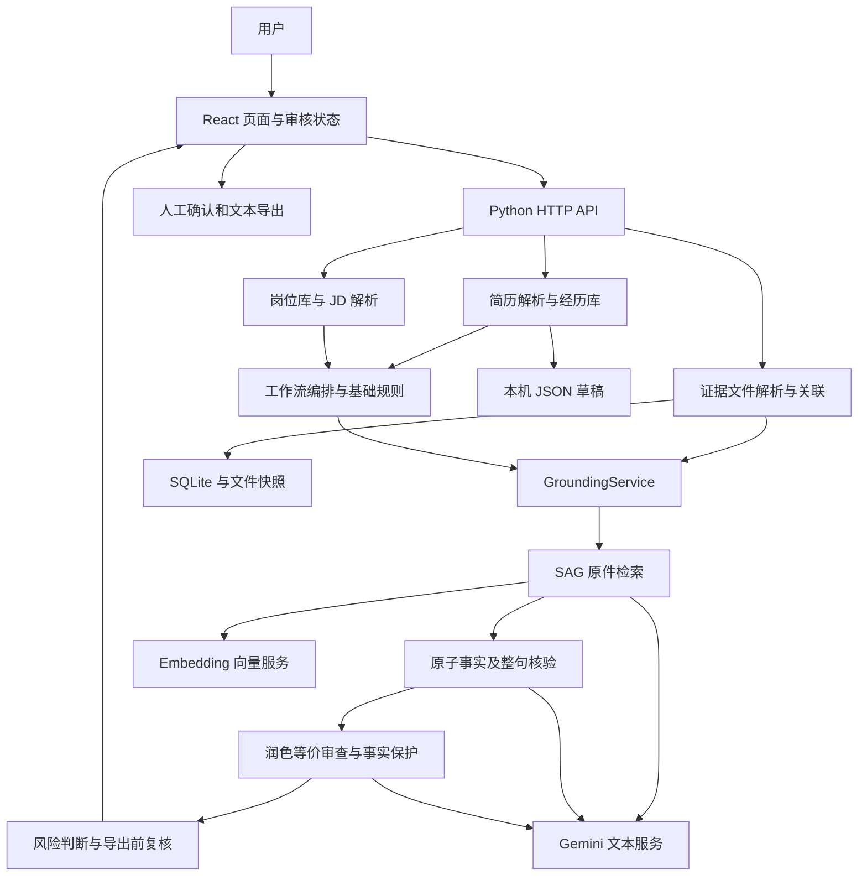

# ApplyGuard 当前实现与代码位置（2026-11-13）

本说明按 GitHub 仓库 `yinzzzzz007-code/applyguard` 的 `feature/ui-review-improvements-20261105` 分支核对。代码基线为 `1eab77cbcd86d79a180ce2834ab3a82a777df89f`，提交时间 2026-11-10 11:07 +08:00。它是本机运行的求职材料审核原型，核心是“经历与原件关联 → 岗位匹配 → 简历陈述核验／润色 → 人工确认与导出”。

当前实际运行结构为 React/Vite 前端、Python 标准库 HTTP 服务、JSON/SQLite 本地存储和 SAG 检索引擎。下文包含 11 月 13 日基于上述 GitHub 提交的修复：首页视频、本机 Harness 安装／启动向导及 `/help` 直达。测试结果另见 [本次测试报告](testing-report-2026-11-13-gemini.md)。

## 1. 整体结构



- 开发时，Vite 默认监听 `127.0.0.1:5173`，把 `/api` 和 `/health` 代理到 `127.0.0.1:8000`。配置见 [vite.config.ts](../frontend/vite.config.ts)。
- 构建后，后端可直接提供 `frontend/dist` 的静态资源及已登记的 SPA 路径。服务入口是 [backend/app.py](../backend/app.py) 的 `create_server()` / `main()`，实现为 `ThreadingHTTPServer`。
- 文本模型与向量服务通过配置的 HTTPS 服务调用。本机保存材料并不意味着模型推理也在本机。
- ATS 是本地模拟表单；当前没有向真实招聘网站自动投递的实现。

## 2. 页面、入口与对应实现

以下前端文件均位于 `frontend/src/`；路由登记在 [App.tsx](../frontend/src/App.tsx)，导航分组在 [navigation.ts](../frontend/src/navigation.ts)。

| 用户看到的入口 | 路径 | 页面文件 | 对应业务与后端 |
| --- | --- | --- | --- |
| 首页／简历导入 | `/` | `pages/ResumeImportPage.tsx` | 默认展开 24 秒操作视频；导入按钮定位 `#resume-import`；PDF 抽取预览调用 `resume_parser.py`，`POST /api/v1/resume/parse` |
| 经历库 | `/vault` | `pages/CareerVaultPage.tsx` | 编辑个人、教育、实习、项目、奖项；`local_store.py` 保存草稿，`resume_draft_vault.py` 转为工作流经历结构 |
| 证明材料 | `/evidence` | `pages/EvidenceWorkspacePage.tsx` | 文件导入、原件预览、字段核对和经历关联；`evidence_workspace.py`、`evidence_parsers.py` |
| 岗位雷达 | `/jobs` | `pages/JobRadarPage.tsx` | 本机岗位收藏、JSON/JSONL 导入、版本与阶段；`job_radar.py`，可选连接外部本机 Radar |
| 岗位说明 | `/jd` | `pages/JdInputPage.tsx` | JD 输入、规则或模型解析，启动工作流；`jd_parser.py`、`skill_router.py` |
| 证据匹配 | `/match` | `pages/EvidenceMatchPage.tsx` | 岗位要求与经历／材料候选、缺口；`evidence_matcher.py`、`ai_evidence_matcher.py` |
| 简历审查 | `/resume` | `pages/ResumeReviewPage.tsx` | 编辑正文、润色预览、等价审核、复核与导出；`grounded_workflow.py`、`wording_review.py`、`review_export.py` |
| 陈述核验 | `/claims` | `pages/ClaimVerificationPage.tsx` | 展示陈述状态、事实拆分、引文和来源；`atomic_verifier.py`、`structured_verifier.py` |
| 网申模拟 | `/ats` | `pages/AtsSimulatorPage.tsx` | 模拟字段映射、复制限制；`reverification.simulator_mapping()`、`risk_engine.py` |
| 最终确认 | `/confirm` | `pages/HumanConfirmationPage.tsx` | 人工确认、复制填写稿、导出前校验、记录模拟结果 |
| 申请记录 | `/history` | `pages/ApplicationHistoryPage.tsx` | 浏览器内模拟申请摘要；`history.ts`，不是招聘平台投递记录 |
| 帮助 | `/help` | `pages/HelpPage.tsx` | 四步操作说明与可选视频；已补齐后端 SPA 路径登记，直接访问和刷新正常 |

前端不是每个页面各自维护一套独立状态：

| 文件／目录 | 职责 |
| --- | --- |
| `context/DemoContext.tsx` | 共享当前 JD、简历表单、工作流、审核决定、导出验证；处理证据变化后的失效 |
| `api/client.ts`、`api/jobs.ts` | HTTP 请求、错误转换、真实／演示场景入口；`api/types.ts` 定义前端数据类型 |
| `resume/review.ts`、`reviewSession.ts` | 审核状态与会话恢复；恢复正文时不继承旧核验授权 |
| `resume/groundingHistory.ts` | 文字版本与回滚；回滚文字不等于恢复证据通过状态 |
| `resume/formModel.ts`、`options.ts` | 表单结构、兼容旧数据和选项 |
| `copyRules.ts` | 控制陈述和字段能否复制，检查最终文字、核验状态与待复核修改 |
| `evidence/materials.ts` | 材料显示状态；解析成功、人工核对、关联经历分别处理 |
| `components/SAGPolishPanel.tsx`、`ReviewDraft.tsx` | 润色、正文编辑和审核操作 |
| `components/AtomicEvidence.tsx`、`EvidenceMatchBoard.tsx` | 原子事实引文及匹配结果展示 |
| `components/GroundedExport.tsx` | 已核验稿／用户确认稿导出入口 |
| `components/AgentConnector.tsx` | 来源授权、每 3 秒自动配对状态、证据候选、导入和撤销 |
| `components/HarnessSetupGuide.tsx`、`agentConnection.ts` | 本机安装检测／步骤、真实路径命令、临时 MCP 配置与连接状态 |
| `components/AppShell.tsx`、`States.tsx`、`i18n.ts` | 页面壳、状态标记、中文文案 |
| `components/ProjectReel.tsx`、`KineticCanvas.tsx`、`motion/` | 首页默认展开的 24 秒 Canvas/WebGL 视频；静音播放、暂停、章节和减少动态效果；帮助页复用；不参与核验 |

## 3. 后端模块具体负责什么

以下服务均在 `backend/services/`。目前是单个 HTTP 服务内的模块分工，没有独立部署的一组微服务。

| 模块 | 输入 → 输出／职责 |
| --- | --- |
| `resume_parser.py`、`resume_sections.py` | PDF → 文字阅读顺序、分节和表单字段；本地规则为基础，可选模型补充，检查模型字段是否来自原文 |
| `local_store.py` | 校验日期、联系方式等并保存 `resume-draft.json`；以保存版本防止覆盖更新 |
| `career_vault.py` | 读取课程演示经历 JSON、基本字段与指标检查 |
| `resume_draft_vault.py` | 用户编辑表单 → 标准 `experience`、`claim`、`evidence_source` 结构 |
| `evidence_parsers.py` | Markdown、PDF、Word、图片 → 原文片段、页码／行号／位置；可选 LibreOffice、PaddleOCR |
| `evidence_workspace.py` | 工作区、文件版本、SHA256、解析片段、材料核对、经历关联、搜索与删除；证据 API 的实际实现 |
| `local_evidence.py` | 把本机有效原件关联附加到经历，供基础工作流读取 |
| `jd_parser.py`、`prompts.py` | JD → 结构化要求及来源片段；模型输出校验、规则回退、提示词版本 |
| `jd_match_scope.py` | 区分个人／教育条件与经历证明，避免把两者的支持状态混在一起 |
| `evidence_matcher.py` | 规则匹配岗位要求与经历，产生相关度、候选与个人条件检查 |
| `ai_evidence_matcher.py` | 可选语义匹配增强；失败可标记为规则回退，不能直接授予事实核验通过 |
| `resume_selector.py` | 从匹配结果挑选简历陈述；适配第三方 bullet selector |
| `claim_validator.py` | 基础确定性检查：陈述归属、证据编号、冲突、指标等；与后续 SAG 模型核验分层 |
| `skill_router.py` | 串联经历库、JD、匹配、选择、核验、字段映射、风险、人工确认、审计；逐模块验证 Schema，失败停止后续步骤 |
| `reverification.py` | 用户编辑后重新构建陈述与映射，避免直接相信客户端传来的已通过状态 |
| `grounded_workflow.py` | 当前核心编排：来源范围、检索、原子核验、润色、等价判断、事实保护、高风险复核、来源失效复查与导出 |
| `sag_grounding.py` | 调用真实 `zleap-sag` 建索引与检索；按候选人／经历限定信源，保存版本缓存，返回可追溯原文 |
| `atomic_verifier.py` | 事实核验与润色接口；真实客户端走结构化核验，另保留模型桩兼容路径 |
| `structured_verifier.py` | 拆分事实、核验原句和每个事实、检查拆分完整性、校验逐字引文、检查数值与单位 |
| `wording_review.py` | OpenAI Agents SDK 驱动的等价判断与最多一次修复；实际文本模型仍为所配置的 Gemini |
| `fact_lock.py` | 事实账本与规则：数字起止、单位、职责归属、技术、否定和限定语等 |
| `edit_guard.py`、`edit_invariants.py` | 改写保真检查、变化审计及局部不变量 |
| `asu_resume.py` | 适配已保留的 ASu 简历写作资源，为润色加入项目约束；上游标签不能替代核验 |
| `risk_engine.py` | 综合陈述、字段及匹配风险，决定阻断／复核和各字段可操作状态 |
| `review_export.py` | 用户确认稿导出：校验最终正文 SHA256、刷新本地规则，明确记录“未经过当前原子核验” |
| `model_client.py` | 共用模型客户端：HTTPS、模型选择、超时、输出限制、结构化输出校验、模型名和用量统计 |
| `schema_validation.py` | 读取 `contracts/` 的 JSON Schema，校验模块输出 |
| `job_radar.py` | 本机岗位 CRUD、版本、阶段、缺口分析、外部 Radar 的只读 API 适配 |
| `agent_bridge.py` | 有期限的来源授权、限定目录／固定 GitHub SHA 搜索、原文证据回传、撤销；授权保存在进程内 |
| `harness_setup.py` | 只读检测本机 Python／MCP／Harness；生成启动器与探针共用的 Gemini 检索 patch，不嵌入密钥 |
| `sag_auxiliary.py` | 另一条可选 SAG 辅助匹配接口，默认关闭；与默认启用的 `sag_atomic` 主核验链不同 |

## 4. 一条简历陈述如何被核验

1. 用户导入简历并核对经历，保存草稿；项目、实习、奖项需要关联材料。姓名、联系方式、教育等走个人资料检查，不算 SAG 证据支持。
2. 证明材料先解析为带位置的原文片段。材料人工核对与关联经历是两次操作。主核验只接纳当前有效、已核对且正确归属的原件。
3. 选择岗位后，JD 解析、匹配与陈述选择建立基础工作流。离线模式会明确跳过模型；模型失败的回退状态不会伪装成模型成功。
4. `GroundingService` 收集来源快照。JD、草稿和模型生成文本不能充当经历原件。
5. SAG 按“支持、反驳、更正”三个方向检索。默认 `full_expand` 使用向量与最多两跳图扩展；生成的事件标签不是证据，最终引用回到原文。
6. `StructuredVerifier` 将每条陈述拆成事实，并同时核对整句。检查引文是否确实存在、是否属于当前候选人与经历；拆分遗漏最多修补一次。
7. 请求润色时，先核验原句，再生成建议、判断等价、必要时最小修复，并重新核验最终文字。事实保护和可选高风险复核都能阻止采用建议。
8. 网络调用结束后再次检查材料版本／关联是否变化。来源被删除、更换或撤销时，使当前结果失效；不能继续沿用旧通过状态。
9. 导出分两条：**已核验稿**要求重新完成核验且全部通过；**用户确认稿**允许保留材料不足／冲突记录，但确认本身不会升级材料支持状态。

| 维度 | 典型值 | 应怎样理解 |
| --- | --- | --- |
| 事实关系 | `SUPPORTED / CONTRADICTED / INSUFFICIENT` | 原文支持、矛盾或不足 |
| 页面核验状态 | `VERIFIED / BLOCKED / NEEDS_REVIEW` | 经历陈述分别映射为通过、阻断、复核；调用失败通常需复核 |
| 表达等价 | equivalent / changed / uncertain | 只说明改写是否保持原义，不说明原句真实 |
| 人工确认 | `user_confirmed` | 用户接受最终文字，不能替代事实核验 |
| 个人资料范围 | `verification_scope=personal` | 可出现内部 VERIFIED 状态，但 `grounded=false`，不能当成经历证据通过 |

## 5. 数据放在哪里

| 数据 | 默认位置 | 生命周期／用途 |
| --- | --- | --- |
| 本机经历表单 | `data/local/resume-draft.json` | 用户保存的草稿；`APPLYGUARD_LOCAL_DIR` 可改目录 |
| 证据索引 | `data/local/evidence/evidence.sqlite3` | `APPLYGUARD_EVIDENCE_DIR` 可改目录；SQLite WAL、外键及锁控制 |
| 原件快照／转换预览 | `data/local/evidence/<workspace_id>/` | 保留文件版本与哈希，定位原件 |
| SAG 索引及缓存 | `data/local/grounding/<candidate-hash>/<snapshot>/<settings-hash>/` | 内含引擎 index、原文、`indexed.json`、`query-cache-v2`；`APPLYGUARD_GROUNDING_DIR` 可覆盖 |
| 岗位库 | `data/local/job-radar.sqlite3` | `opportunities` 和 `opportunity_versions` 两张表 |
| 审核会话／未保存文字 | 浏览器 `sessionStorage` | `applyguard.review-session.v1` 等；恢复时不复用旧批准 |
| 模拟申请历史 | 浏览器 `localStorage` | `applyguard.applicationHistory.v1`；仅模拟摘要，不是服务端投递记录 |
| 外部 Agent 授权 | 后端进程 `GRANTS` 字典 | 默认 30 分钟，到期／撤销失效，服务重启不保留 |
| 工作流审计 | 响应内 `audit_record`、`step_trace` | 当前以响应／内存记录为主，不能视为独立、持久的审计平台 |
| 公开演示样本 | `data/career-vault.seed.json`、`data/evidence-samples/`、`frontend/public/` | 虚构演示素材，与真实用户资料分开 |
| 测试与模型实验 | `output/test-reports/`、`output/`；历史冻结集在 `eval/` | 本次输出被 Git 忽略；历史报告不能当作本次测试结果 |

证据库的关系为：`workspace → source_file → source_span`；`evidence_record` 通过 `evidence_span` 关联片段，`evidence_link` 再把材料关联到经历／奖项，并绑定文件 SHA256。修改同路径文件会形成版本变化，旧关联需复核。

## 6. 主要 API 与契约

统一入口在 `backend/app.py`，主要业务路径如下。各模块的 `handle_*` 函数是完整路由的直接查找入口。

| API | 用途 |
| --- | --- |
| `GET /health` | 后端存活状态 |
| `POST /api/v1/resume/parse` | PDF → 简历表单 |
| `GET / POST /api/v1/resume/draft` | 读取／保存本机草稿 |
| `POST /api/v1/workflow/mock` | 历史命名；当前承载基础工作流并接入 grounding，不代表请求必定为假数据 |
| `POST /api/v1/workflow/reverify` | 编辑后的重新核验 |
| `POST /api/v1/resume/polish` | 润色与后续保护流程 |
| `POST /api/v1/resume/export` | 已核验稿／用户确认稿导出 |
| `/api/v1/evidence/workspaces`、`.../{id}/files` | 建立工作区、列出或导入文件 |
| `/api/v1/evidence/files/{id}`、`.../preview`、`.../reparse` | 文件信息、预览、重新解析；支持删除 |
| `/api/v1/evidence/{id}/review`、`.../links`、`.../links/remove` | 材料核对、建立或撤销经历关联 |
| `/api/v1/evidence/search`、`.../check-claim`、`.../workspaces/{id}/match-resume` | 本地搜索和材料候选检查；不等于完整原子核验 |
| `/api/v1/jobs`、`.../import`、`.../{id}/versions` | 岗位列表、导入、版本；另有 edit、stage、analyze |
| `/api/v1/jobs/radar`、`.../radar/import` | 读取并导入外部本机 Radar 岗位 |
| `POST /api/v1/agent/ui`、`.../agent/call` | 同源界面环境检测、授权、状态、撤销；Agent 令牌预检／任务／搜索／回传；预检不标记配对 |

`contracts/` 的九份 JSON Schema 分别是：`experience`（经历）、`parsed-jd`（岗位要求）、`evidence-match`（匹配）、`resume-claim`（陈述）、`claim-verification`（核验）、`form-mapping`（表单映射）、`risk-result`（风险）、`audit-record`（审计）、`error`（错误）。前端对应类型见 `frontend/src/api/types.ts`。

## 7. 模型、外部集成与配置

本次已在独立检出目录的 `.env` 中统一普通、复杂、高风险复核文本模型；该文件不含密钥且被 Git 忽略。密钥只通过隐藏输入进入测试进程。

| 配置项 | 本次值 | 使用位置 |
| --- | --- | --- |
| `APPLYGUARD_AI_BASE_URL` | `https://api.chatanywhere.tech/v1` | `HttpModelClient`、SAG、wording SDK |
| `APPLYGUARD_AI_MODEL` | `gemini-3.1-flash-lite-preview` | 简历／JD 解析、语义匹配、SAG 文本处理 |
| `APPLYGUARD_COMPLEX_AI_MODEL` | 同上 | 原子事实核验、润色与保真判断 |
| `APPLYGUARD_STRONG_AI_MODEL` | 同上 | 可选高风险二次判断；本次启用且不切换其他文本模型 |
| `APPLYGUARD_EMBEDDING_MODEL` | `text-embedding-3-small` | SAG 向量化，1536 维；文本生成模型不能直接替代 embedding |
| `APPLYGUARD_GROUNDING_MODE` | `sag_atomic` | 默认要求原子核验，客户端不能主动降级 |
| `APPLYGUARD_GROUNDING_STRATEGY` | `full_expand` | SAG 向量与图扩展检索 |

OpenAI Agents SDK 在这里是兼容 API 的调用框架，不代表系统使用了 GPT 模型。`wording_review.py` 显式传入 Gemini 模型、ChatAnywhere 地址，关闭 SDK tracing 和隐式重试。

其他集成：`scripts/agent_mcp.py` 以 MCP stdio 提供 `get_task`、`search_materials`、`submit_evidence`；外部 Radar 默认在 `127.0.0.1:8787`，仅导入岗位；LibreOffice 支持旧 Word 转换，PaddleOCR 支持扫描件／图片识别，均为可选本机依赖。

第三方代码与资源见 `THIRD_PARTY_NOTICES.md`、`backend/services/third_party/`、`third_party/asu-skills/`、`vendor/kinetic-reel/` 和 `third_party_licenses/`。它们分别服务于陈述筛选、指标算术、输入清洗、写作参考及动效，不应混作同一“核验模型”。

## 8. 如何运行、验证和修改

本次独立检出目录为 `applyguard-gemini-20261113`，使用外层工作区现有 `.venv`，依赖按本提交的 `requirements-sag.txt` 补齐。以下命令在此检出目录运行；普通新克隆可先创建自己的 `.venv` 并调整 Python 路径。

```powershell
# 输入密钥时隐藏，不写入文件
..\.venv\Scripts\python.exe scripts/run_grounded.py

# 另一个终端启动前端
cd frontend
npm run dev -- --host 127.0.0.1
```

| 想验证／修改什么 | 首先找哪里 | 现有验证入口 |
| --- | --- | --- |
| 全量后端行为 | `backend/`、`tests/` | `python scripts/run_test_report.py --label <label> --all` |
| 前端构建与审核状态 | `frontend/src/` | `npm run build`、`npm run lint`、`npm run smoke` |
| 简历读取异常／分节 | `resume_parser.py` | `test_resume_abnormal.py`、`test_resume_sections.py` |
| 文件导入、版本、关联与本地 OCR | `evidence_workspace.py`、`evidence_parsers.py`；可用 `APPLYGUARD_OCR_PACKAGES` 指定库目录、`PADDLE_PDX_CACHE_HOME` 指定模型目录 | `test_evidence_workspace.py`、`test_docx_extract.py`；真实 OCR 应检查结果为通过而非跳过 |
| JD 与经历匹配 | `jd_parser.py`、`evidence_matcher.py` | `test_jd_chinese_offline.py`、`test_jd_match_scope.py`、`test_ai_evidence_matcher.py` |
| SAG 与事实核验 | `grounded_workflow.py`、`sag_grounding.py` | `test_grounding*.py`、`test_quote_alignment.py`；真实模型需额外执行 live 测试 |
| 改写不能改事实 | `wording_review.py`、`fact_lock.py` | `test_wording_review.py`、`test_numeric_wording_regression.py`、`test_edit_preservation_v2.py` |
| 人工确认与导出分离 | `review_export.py`、`copyRules.ts` | `test_review_export.py`、前端 review／copy-rules／review-session 测试 |
| 岗位与外部 Agent | `job_radar.py`、`agent_bridge.py` | `test_job_radar.py`、`test_agent_bridge.py`、`test_agent_mcp.py` |
| 本机 Harness 接入 | `harness_setup.py`、`scripts/connect_harness.py`、`HarnessSetupGuide.tsx` | `test_harness_setup.py`、`agent-connection.test.mjs`、`scripts/agent_browser_smoke.cjs`、`scripts/harness_agent_probe.py` |
| 首页视频、导入入口、移动布局 | `ResumeImportPage.tsx`、`ProjectReel.tsx`、`KineticCanvas.tsx`、`workspace.css` | `scripts/home_browser_smoke.cjs`（真实浏览器、带日期截图） |
| `/help` 后端直达／刷新 | `backend/app.py` SPA 路径表 | `tests/test_api.py` 的 `test_help_deep_link_serves_spa` |

`scripts/live_grounding_pilot.py` 使用五组虚构材料，包含支持句、错误句及仅检索润色预览。它的退出码不能代替效果检查，必须读 `grounding.error` 与各条核验状态；本次另记录默认原子模式的完整 HTTP 复测。详细结果和限制见本次测试报告。

当前范围仍是本机原型：真实中文 OCR 已通过一项合成图片用例，不能代表多种扫描质量下的准确率；真实招聘投递、外部 Radar 的在线运行、独立真人标注的模型准确率以及生产级多用户隔离，尚未由本次自动化测试验证。

## 11. 本机 Harness 一次检索的路径

`/evidence` → `AgentConnector` → 同源 `/agent/ui setup` → 检测并显示安装步骤 → 用户选择材料与外发规则 → `/agent/ui create` 返回 30 分钟能力凭据 → 复制生成的 PowerShell 命令 → `scripts/connect_harness.py`。

启动器先调用 `/agent/call prepare` 校验有效性和云端授权，再创建独立临时 profile，启动已安装的 `dsh`。Harness 的 MCP stdio 插件运行同一 Python 下的 `scripts/agent_mcp.py`，经本机 HTTP 使用三个工具：`get_task`、`search_materials`、`submit_evidence`。模型和 API 地址取当前配置，Key 隐藏输入，仅传运行进程。

只有实际 `get_task` 后后端才标记配对。前端轮询拿到候选原文；用户核对归属、数字后导入原工作区，随后仍经过材料关联与原子核验。Harness 不能直接批准陈述。离页／撤销／超时使凭据失效，独立检索进程退出后清理临时 profile。完整操作见 [连接文档](agent-connector.md)。
