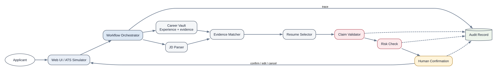
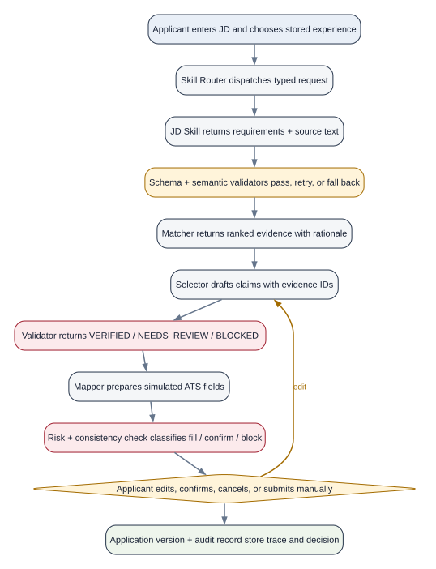

# Architecture and workflow

## Architecture baseline

The selected ApplyGuard topic is the design source of truth. The dependency-free service in this repository is a proposal scaffold, not a replacement for the target architecture below.

## Architecture diagram

## Workflow diagram

## Core sequence diagram

## Module responsibilities

| Module | Responsibility | Input | Output | Owner after A handoff |
| --- | --- | --- | --- | --- |
| Web App | Present Career Vault, jobs, resume choices, risks, and corrections | User actions + API results | User decisions | D |
| ATS Page Scanner | Read a proposal simulator first and one limited ATS environment in the final project | ATS page structure | ATS field inventory | D |
| Application API | Expose versioned endpoints and unified errors | Web/extension requests | Contract-valid responses | A |
| Workflow Orchestrator | Maintain state, order modules, enforce stops, and record the trace | Application request | Workflow events | A |
| Skill Router | Dispatch typed requests to specialized skills and apply retry/fallback policy | Skill envelope | Validated skill result | C, architecture by A |
| Career Evidence Graph | Store experiences, claims, skills, metrics, sources, confidence, and verification links | Experience edits | Experience JSON | B |
| JD Parser Skill | Extract hard and preferred requirements with confidence and source evidence text | JD text | Parsed JD JSON | C |
| Evidence Matcher Skill | Score relevant evidence and explain strength, conflicts, and missing support | Parsed JD + Experience | Evidence Match JSON | B |
| Resume Selector Skill | Optimize claim selection under length, evidence, impact, and redundancy constraints; explain selection and removal | Evidence Match | Resume Claim JSON | B |
| Claim Validator | Check every statement, expose unsupported fragments, and block unsafe claims | Resume Claim + evidence | Claim Verification JSON | C |
| ATS Form Mapper Skill | Map approved content into ATS fields and expose missing or inconsistent fields | Field inventory + verified claims | Form Mapping JSON | D |
| Risk Skill | Classify actions as safe to fill, requiring confirmation, or blocked | Verification + mapping | Risk Result JSON | C |
| Human Confirmation | Let the user edit, confirm, cancel, and manually submit | Risk Result + draft | User Decision JSON | D |
| Audit Record | Save application version, trace, inputs, decisions, and outcome | Workflow events | Audit Record JSON | A integration, D UI |

## Validation and execution path

Every AI-assisted skill follows the same boundary:

`Workflow Orchestrator → Skill Router → Specialized Skill → JSON Schema Validator → Semantic Validator → Pass / Retry / Deterministic Fallback`

The proposal scaffold may return a deterministic fixture at the Specialized Skill boundary. B, C, and D replace fixtures without changing the external contract unless the team versions the contract.

## Data and technology direction

- Target web stack: React/Next.js frontend and a versioned Python API, preferably by reusing the Resume Matcher foundation after a short compatibility review.
- Target evidence store: PostgreSQL with pgvector for retrieval, plus explicit relational links for claims, metrics, evidence sources, confidence, and verification state.
- Proposal data: fictional JSON fixtures only.
- ATS integration: a controlled simulator before the proposal and one limited final-project target; the user performs the final submission.
- AI boundary: models may extract, rank, draft, or explain. Deterministic code validates schemas, checks evidence support, applies risk policy, and controls state transitions.

## Control boundaries

- Deterministic code handles schema validation, semantic checks, constraints, state transitions, and the confirmation gate.
- AI components may parse or draft content, but they cannot bypass contract validation or user confirmation.
- The proposal demonstration uses fictional data and ends before external submission.
- Every module logs a trace ID so a failure can be connected to its input and output.
- The current standard-library server is disposable scaffolding. A records the reuse decision before the team adopts a final framework.
