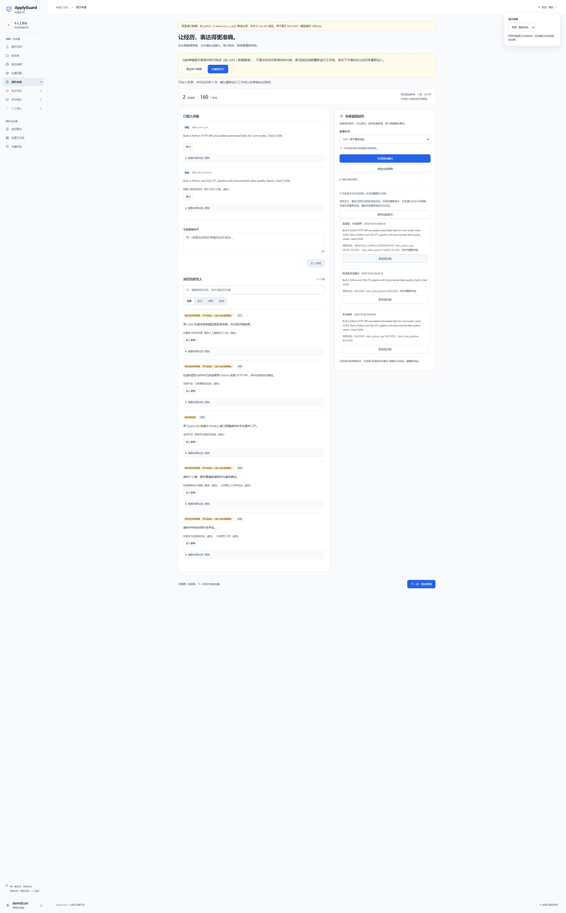

# 浏览器人工操作冒烟 · 2026-10-30

- 时区：Asia/Shanghai；检查时段约 00:43—00:48。
- 对象：发布副本生产构建，127.0.0.1:8871；虚构预录阻断场景。
- 已观察：本地解析默认选项；经历库加载；岗位→匹配→简历审查；SAG 方式选项；手动保存版本；移出后正文 2→1；回滚后正文 1→2；恢复后的状态为待重新核验，历史中生成回滚前备份。
- 浏览器捕获的 error 日志为空。上述是单次操作冒烟，不是跨浏览器或完整端到端测试。
- 未调用真实模型；不用于模型效果评分。

